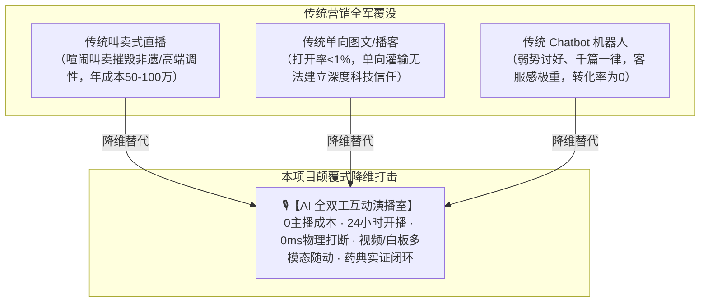
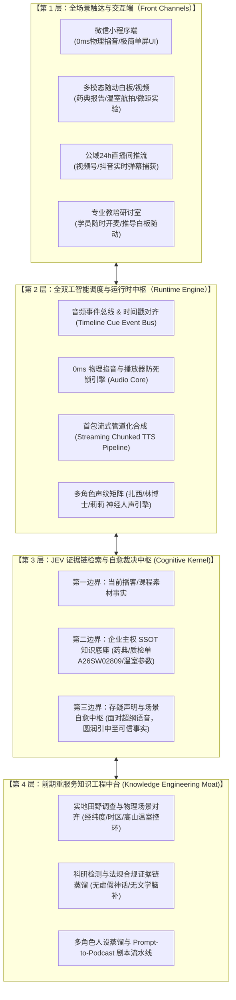
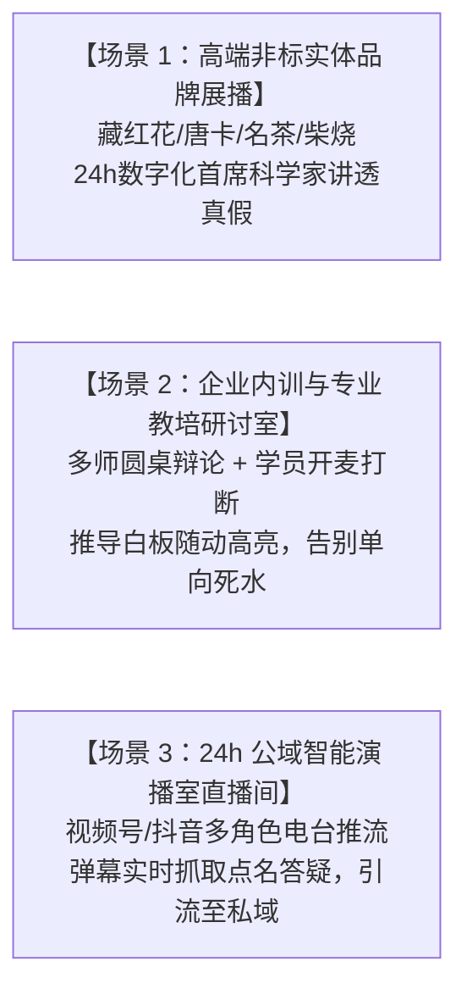
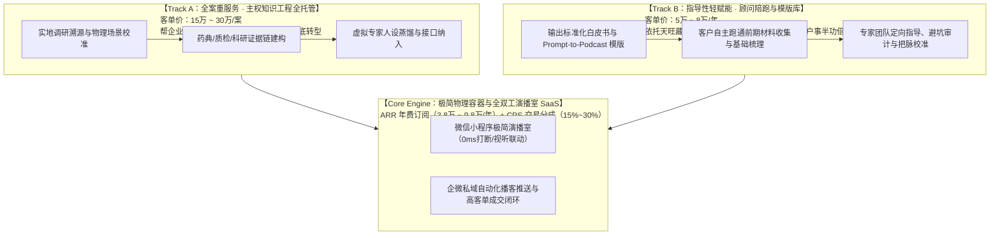

# 🚀【商业融资与政府立项白皮书】
# AI 全双工互动演播室系统（AI Full-Duplex Interactive Studio OS）
## ——面向万亿高客单非标与文化实体产业的下一代多模态互动媒体与营销操作系统

**编制时间**：2026-10-01  
**项目代号**：Project Saffron Studio / Brand Content OS  
**项目阶段**：MVP 全链路闭环已验证 · 微信真机全双工跑通 · 商业化放量前夜  
**核心客群**：天旺农牧（名贵药材）、非遗唐卡、古树名茶、非遗藏香、名家柴烧、高端康养等高客单重认知企业

---

## Executive Summary（项目执行摘要）

当今所有高客单、重认知、深文化的实体产业（如高端滋补、名贵中药、非遗艺术、高端名茶）在传统数字化营销中面临**两大不可逾越的死局**：
1. **叫卖式带货直播摧毁品牌调性**，且 5 人专业直播团队年成本高达 50~100 万元，中小企业难以为继；
2. **传统图文公众号/单向播客打开率跌破 1%**，单向灌输无法解答高净值客户对真假、药典、工艺的深刻疑虑。

**本项目自主研发的【AI 全双工互动演播室系统（AI Full-Duplex Interactive Studio OS）】，在微信小程序生态中彻底实现了“听众随时开麦物理掐音、多位 AI 专家多层递进协同解答、视频/白板视听随动演示、平滑回归主线”的革命性体验！**

本项目已在标杆客户“西藏天旺农牧（林芝海拔2945米高山藏红花基地）”上完成软硬件全链路真实闭环。系统**免除所有真人主播与昂贵硬件成本**，依托主权 AI 算力池与神经人声引擎，打造 24 小时常温运转的虚拟演播室，构建起**“B2B 企业 SaaS 订阅 + 交易流水分成（CPS）+ 自营文化 IP 矩阵”**的万亿级商业飞轮！

---

## 一、 市场痛点与时代机遇（Why Now?）

### 1. 行业致命痛点
* **高客单产业决策极难**：一克特级藏红花百元、一幅矿物颜料唐卡数万元、一饼古树普洱数千元。消费者绝不会冲动下单，他们心存无数关于真伪、产地、药典、农残的复杂困惑；
* **人效与人才断层**：既懂《中国药典》又懂植物化学、既懂藏地风土又具备播音主持能力的专业复合型人才凤毛麟角，实体企业根本请不起、留不住。

### 2. 生成式 AI 工业级奇点（The Timing）
大语言模型的多模态原生听觉（Multimodal Audio Understanding）与实时神经网络人声（Neural TTS）在 2026 年迎来质的飞跃。我们率先将该底层能力工程化为微信端无需任何 VPN、开包即用的“全双工演播室”，抢占了全球互动音频第一生态位。

---

---

## 二、 系统整体技术架构蓝图（System Architecture Blueprint）

### 1. 终极护城河公理：硬技术终被迭代，唯有“从故事走向真实”的重服务不可逾越

> **【战略定海神针】**  
> 纯粹硬技术层面的代码（模型 API、全双工通讯、TTS合成）随时可能被模仿、被超越，这是不可逆转的大势所趋。  
> **真正坚不可破的护城河，是我们在前端重服务环节的“主权知识工程与证据链体系”**：  
> * **对品牌与物理现场的骨骼级梳理**（剔除一切脱离物理常识的文学脑补）；  
> * **对企业科研证据链与主权知识库的严密建构**（药典、质检、经纬度温室数据）；  
> * **帮助企业彻底脱离“单凭编故事讲情怀的易碎营销”，全面跃迁至“以真实证据链为底座的真实营销（Reality-Proof Marketing）”**！  
> 
> 这套基于天旺农牧藏红花及西藏高价值非标产业打磨成型的知识工程沉淀，才是竞品永远无法抄袭的高维壁垒。

### 2. 四大底层技术支撑矩阵
1. **0ms 物理掐音与双工接力引擎**：
   彻底解决移动端网络时延与播放器死锁，听众一键开麦，当前正在说话的主持人声音瞬间清零，0.1秒导播极速垫话破冰，多位专家依次接力；
2. **JEV 三大边界与自愈裁决机制**：
   - 第一边界：当前播客主题素材事实；
   - 第二边界：企业品牌主权知识库（国家药典、质检报告 A26SW02809、高山温室参数）；
   - 第三边界：外部联网事实与存疑声明（面对超纲非结构化语音，如手机操作话题，自愈引申至基地手机物联网智控，不卑不亢，圆润自洽）；
3. **软技术“语境与场景必须吻合”最高公理**：
   摒弃所有 AI 文学脑补套话，每一句台词建立在真实经纬度时差（林芝东经94.4°）、真实 CEA 智能温室控光能力、真实开花到开谢植物生理临界峰值期之上；
4. **多模态视听随动切屏矩阵**：
   口语播报与视觉实证声画合一。聊到温室自动切 4K 航拍，聊到药典自动切可缩放质检单白板，聊到水试自动切微距释放视频！

---

## 三、 三大杀手级核心落地场景（Three Pillar Scenarios）

### 场景 1：高端非标实体品牌展播（Brand Showcase & Sovereign Media）
* **代表客户**：西藏天旺农牧（藏红花）、勉唐派唐卡画院、名山普洱茶庄园、景德镇非遗柴烧工坊。
* **业务痛点**：客单价高达数千至数万元，决策链极长，客户对真伪、药典、工艺充满深层疑虑，传统主播成本高且不懂科学。
* **演播室赋能**：
  - 打造“扎西（文化官）+ 林博士（科学家）+ 莉莉（调度主持）”黄金专家团；
  - 听众随时开麦提问，系统随动展示检测单白板与微距水试视频；
  - **效果**：用无可辩驳的科学证据链打破信任坚冰，直接促成高客单转化！

### 场景 2：企业内训与专业教培研讨室（Corporate Training & EdTech Mastery）
* **代表客户**：大型企业内训（合规/风控/销售战法）、重度职业考试机构（法考/医考/CPA注册会计师）。
* **业务痛点**：传统录播课完课率不足 15%，学员被动挂机；真人名师 1 对 1 答疑成本过高，无法普及。
* **演播室赋能**：
  - **苏格拉底式多师辩论**：主讲导师讲解核心法理，助教提出刁钻实战案例，多维度碰撞启发思维；
  - **学员随时开麦打断研讨**：“老师，刚才讲的民法典第153条在建设工程合同里怎么适用？”演播室立即停下，实时切换对比白板定向深度剖析；
  - **效果**：被动听课变为沉浸式思维碰撞，完课率提升至 80% 以上！

### 场景 3：24 小时公域智能演播室直播间（24/7 Smart Live Streaming Matrix）
* **代表平台**：微信视频号、抖音、快手。
* **业务痛点**：市面无人直播和 2D 单人数字人被平台严厉打击（判定录播违规、停留率极低、转化极差）。
* **演播室赋能**：
  - **打破假人感**：输出高品质多角色广播剧场级声场，配合基地 4K 慢直播与实景切片；
  - **弹幕实时捕获与点名破冰**：观众在公屏打字提问，导播莉莉 0.8 秒内口播点名（“*感谢【雪域老李】的提问…*”），专家立刻调取证据白板现场解答；
  - **公私域联动闭环**：公域直播间全天候吸引泛流量，贴片引导进入小程序演播室开麦互动，沉淀私域超级 VIP 用户！

---

## 四、 “前台极简，前期重服务”的双轨商业飞轮（Business Model）

### 1. 交付形态：双轨制服务与 SaaS 融合（High-Touch Engineering + High-Margin SaaS）

#### 轨道 1：全案重服务 · 主权知识工程深度赋能（Turnkey High-Touch Consulting）
* **收费模式**：**15万 ~ 30万元/案（一次性知识工程服务费）**；
* **交付物清单（Deliverables）**：
  1. **《企业主权物理与科研事实白皮书（SSOT）》**：经纬度时区、生产环境参数、科研论文与质检报告链；
  2. **《品牌去伪存真审计报告》**：清理所有虚假文学编造与法规违规风险点；
  3. **3 人虚拟专家团专属人设图谱与提示词工程包**；
  4. **全套全双工互动演播室系统接口灌装与上线交付**。

#### 轨道 2：指导性轻赋能 · 顾问陪跑与自建指导（Methodological Advisory & Guided SaaS）
* **收费模式**：**5万 ~ 8万元/年（顾问指导与系统授权包）**；
* **服务内容**：
  - 适用于希望自主掌控内容、培养内部品宣团队的客户；
  - 客户自行跑通前期材料收集与初梳理，由我方团队提供方法论指导；
  - **核心背书**：依托我们在西藏天旺农牧藏红花、雪域农特产品、传统唐卡艺术等极其严苛的非标行业中所累积起的丰富知识工程心法，为客户提供避坑指南与质量审计，帮助客户**事半功倍**！

### 2. 持续盈利引擎：B2B SaaS 订阅 + 算力服务费（ARR 核心）
* **轻量版（3.8 万元/年）**：
  标准演播室小程序嵌入、基础多音轨虚拟专家团、年 10,000 次听众双工打断算力；
* **专业品牌版（9.8 万元/年）**：
  专属人设专家团（3人）、对话式品宣工作台、企微私域定向推送、多模态视频随动组件；
* **旗舰版（20 万元/年）**：
  创始人专属声纹克隆、独立域名与私有化算力节点支持、24小时公域直播推流伴侣。

### 3. CPS 交易流水佣金分成（高爆发利润池）
* 听众在演播室中建立起坚不可摧的“事实科研信任”，下方直接承接基地特级产品成交；
* 签署联营协议，按销售额抽取 **15% ~ 30%** 佣金分成。

### 4. 自营高净值文化播客矩阵（流量护城河）
* 打造喜马拉雅地理、藏药哲学等自营垂直频道，沉淀数十万高净值听众，通过会员、定制游学与品牌联名变现。

---

## 五、 行业横向矩阵扩张蓝图（The Industry Matrix）

本产品以天旺农牧为**“第一行业标杆样板间”**，可零边际成本横向复制到数千个高端垂直实体赛道：

| 行业赛道 | 标杆案例 | 演播室专家矩阵 | 核心攻坚壁垒与知识底座 | 商业客单价 |
| :--- | :--- | :--- | :--- | :--- |
| **高原道地中药材** | 西藏天旺农牧·藏红花电台 | 扎西（文化官）+ 林博士（科学家）+ 莉莉（调度） | 《中国药典》水试特征、A26SW02809 报告、2945米高山温室控光 | 100~3,000 元/盒 |
| **职业教培与内训** | 智法堂·民商法全双工演播室 | 罗教授（法理讲师）+ 资深审判长 + 助教 | 《民法典》司法解释、最高院指导案例图谱、庭审证据规则 | 2,000~15,000 元/年 |
| **雪域非遗艺术** | 拉萨勉唐派·唐卡与造像电台 | 旦增（画师）+ 格桑（艺术史学者）+ 卓玛（主理人） | 《度量经》黄金比例、纯天然矿物颜料晶体、画派传承谱系 | 3,000~50,000 元/幅 |
| **千年雪域藏香** | 沉水烟岚·藏香哲学电台 | 索朗（古法匠人）+ 藏医药剂师 + 导播 | 《四部医典》芳香开窍、三十味天然藏药配伍、零化学黏粉 | 300~2,000 元/管 |
| **高端名山茶文化** | 倚邦古韵·普洱古树茶电台 | 寨子老茶农 + 农业大学茶学教授 + 茶席主理人 | 树龄微生态、多酚类转化光谱、纯手工杀青锅温曲线 | 800~10,000 元/饼 |
| **非遗名家柴烧** | 泥火淬炼·景德镇柴烧电台 | 窑变把桩师傅 + 陶瓷鉴定专家 + 策展人 | 松木落灰成釉、1300℃还原焰气氛、显微气泡晶体结构 | 1,500~20,000 元/件 |

---

## 六、 财务预测与经营目标（Financial Projections）

### 1. 单个标杆客户单元经济模型（Unit Economics - 以天旺农牧为例）
* **年 SaaS 订阅收入**：9.8 万元
* **年算力与服务器边际成本**：约 0.3 万元（主权算力池 + 边缘神经人声合成）
* **毛利率**：**96.9%**！
* **CPS 衍生收益预估**：企微私域 5,000 高净值客群，年促成互动下单 100 万元，抽取 20% 佣金 = 20 万元；
* **单个企业年度综合价值（LTV）**：**~30 万元/年**！

### 2. 三年营收规模推演
* **Year 1（样板打造与行业验证）**：
  深耕藏红花与教培/唐卡标杆，服务 30 家标杆企业，自营沉淀 10 万高净值听众；
  **预期营收：450 万元，净利润率 > 65%**；
* **Year 2（矩阵放量与企微私域裂变）**：
  扩展至名茶、藏香、柴烧陶瓷、企业内训等品类，企业客户数达 150 家；
  **预期营收：2,800 万元，净利润率 > 70%**；
* **Year 3（行业事实标准与平台化）**：
  开放企业端自建演播室 SaaS 工作台，服务企业客户 600 家，自营平台用户 100 万；
  **预期营收：1.1 亿元**！

---

## 六、 融资与立项资金规划（Fundraising & Grant Allocation）

### 1. 本轮融资/立项核心诉求
* **融资形式**：天使轮股权融资 / 科技成果转化专项立项补贴 / 文化数字化创新专项基金；
* **资金规划规模**：**人民币 300 万 ~ 500 万元**；
* **资金用途分配**：
  1. **研发与算力工程（40%）**：多模态视听随动矩阵（视频与交互白板随动导入）、企业级 Prompt-to-Podcast 编辑器开发；
  2. **行业知识工程与软技术审计（30%）**：聘请农学、中医药、唐卡艺术专家，建立车规级行业事实中台；
  3. **标杆市场拓展与企微生态打通（20%）**：天旺农牧全国渠道巡展推广、拉萨文化非遗样板打造；
  4. **知识产权与合规安全（10%）**：申报“AI全双工互动演播室系统”发明专利与软件著作权。

---

## 七、 结论：为什么我们能赢？

1. **我们不卖概念，我们有已经跑通的微信真机产品**：
   从底层麦克风唤起、0ms掐音、大模型多模态直连、到多层递进解答，每一个代码字节都经过了真实 iPhone 真机实战检验；
2. **我们懂硬技术，更懂产业级“软技术”**：
   我们立下了“语境必须与物理场景绝对吻合”的最高公理，消灭虚假文学套话，树立了无法被击穿的产业认知主权；
3. **我们拥有无与伦比的降本增效说服力**：
   拿着这台手机，当场向任何高客单文化企业老板展示一次开麦互动——**他们所看到的不仅是一个技术 Demo，而是一支不需要发工资、不需要配录音棚、24小时为他们卖货讲文化的梦幻专家团！**

---
*编制团队：Project Saffron Studio / Interactive Podcast OS 联合发起人*  
*保密级别：商业机密 / 融资与立项专用*
