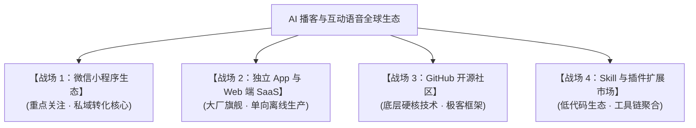

# 🔍【行业深度市调与竞品全景报告】
# AI 全双工互动演播室（AI Full-Duplex Studio OS）全球竞争格局与小程序生态位剖析

**调查时间**：2026-10-02  
**调查范围**：微信小程序生态、主流应用商店（iOS/Android）、GitHub 开源社区、AI Skill / 插件市场（Coze/Dify/OpenAI Store）  
**核心关注点**：微信小程序生态成熟度、全双工打断能力、多角色圆桌形态、重服务知识工程壁垒

---

## 一、 市调核心发现与战略定论（Executive Findings）

通过对全网四大生态的深度穿透式市调，我们得出了一个极其振奋人心的**战略定论**：

> **【核心市场真空】**  
> 整个市场目前呈现出严重的“两极分化”——  
> 1. **一端是纯粹的“生成即完事”的静态音频生产工具**（如 NotebookLM、豆包长文转播客、Podcastfy），只能离线生成单向音频，**完全无法在收听过程中随时打断提问**；  
> 2. **另一端是客服/交友式的“单人单口 1 对 1 语音通话”**（如豆包语音通话、Glow、Character.ai），是单人聊天，**缺乏多角色圆桌演播室的智识密度与视听随动，更没有任何产业级严肃证据链**；  
> 
> **在微信小程序生态中，至今【没有任何一家产品】能够实现：**  
> **“多角色广播级圆桌演播室 + 听众 0ms 物理开麦打断 + 专家依次接力自愈答疑 + 多模态证据白板随动 + 实体产业 SSOT 知识工程沉淀”！**  
> 
> 我们正在构建的不仅不是红海竞品，而是**在微信万亿私域生态中，首创了一个独一无二的“全双工实体产业互动媒体操作系统”**！

---

## 二、 四大主战场竞品全景穿透分析

### 战场 1：微信小程序生态（当前现状与真空点）

微信小程序是国内高净值实体企业（天旺农牧、唐卡画院、名茶庄园）进行私域沉淀与商业变现的唯一主阵地。

| 代表产品/类型 | 核心模式与交互形态 | 致命局限与缺陷 | 与本项目的本质区别 |
| :--- | :--- | :--- | :--- |
| **故宫博物院《听宝贝说》等官方文博小程序** | 录音跟读评测，生成带有用户音色的固定讲解音频。 | 纯单向线性播放，无自由开麦打断，属于静态音频播放器。 | 我们支持收听任意秒数即时开麦，AI 专家团多层接力答疑。 |
| **小宇宙 / 喜马拉雅小程序** | 传统播客音频托管与流媒体播放器，带有 AI 文本字幕与速读总结。 | 依然是“人录、人听”的单向死水，用户无法介入节目。无法为实体品牌提供定制化专家矩阵。 | 我们是“无主持人、24小时常温运行、听众是节目第四位嘉宾”的活体演播室。 |
| **腾讯云/微信官方 AI 对话体验小程序** | 基于 DeepSeek/混元单模型的一问一答打字或单轮语音客服。 | 单一客服人设，机械冰冷，缺乏广播级沉浸感；无多角色研讨剧场，无产业级证据链。 | 我们是 3 位性格鲜明的虚拟科学家与文化传承官共同构成的广播级智识场。 |

---

### 战场 2：独立 App 与 Web 端 SaaS（离线生成 vs 实时对齐）

| 竞品产品 | 出品方/背景 | 核心能力 | 缺陷与不可逾越的鸿沟 |
| :--- | :--- | :--- | :--- |
| **NotebookLM** | Google | 上传 PDF/文档，自动生成极其逼真的双人对谈播客（Audio Overview），逻辑严密。 | 1. **纯单向离线音频**（生成完就是一个不可互动的 MP3）； 2. 无法在播放中实时开麦提问； 3. 无法嵌入微信生态，对国内企业私域毫无价值。 |
| **豆包（AI 播客 / 语音通话）** | 字节跳动 | 1. 文档一键转双人播客； 2. 支持 Seeduplex 端到端全双工实时语音通话。 | 1. 播客功能与通话功能完全割裂（听播客不能打断，打电话只是单人客服）； 2. 公域通用娱乐属性，缺乏垂直实体产业的严肃质检证据链。 |
| **通义听悟 / Monica AI** | 阿里 / 独立厂商 | 长音频/长文档摘要，支持多语种播客生成与思维导图提炼。 | 工具属性极重，没有“品牌主权演播室”的专属交付形态，无法沉淀企业自己的私域品牌资产。 |
| **ListenHub / AnyToSpeech** | 独立 AI 创业团队 | 专注于长音频生产、音色克隆与后期模板封装。 | 仅解决“音频制作降本”，未解决“听众信任与高客单转化”的互动闭环。 |

---

### 战场 3：GitHub 开源社区（底层框架级技术对比）

GitHub 代表着全球极客探索的最前沿。

| 开源项目 | 架构方案 | 技术亮点 | 为什么不能直接作为商业产品？ |
| :--- | :--- | :--- | :--- |
| **[Moshi (kyutai-labs)](https://github.com/kyutai-labs/moshi)** | Speech-to-Speech (S2S) 端到端原生全双工大模型。 | 160ms 极致低延迟，能听能说同时进行，情绪自适应。 | 算力成本极其昂贵（需专用高端 GPU 独占常驻），无法在微信小程序轻量化运行，且极难受控约束其输出事实。 |
| **[protoVoice (Pipecat)](https://github.com/protoLabsAI/protoVoice)** | 基于 Pipecat 框架的自适应打断（Adaptive Barge-in）语音 Agent。 | 模块化管道：VAD + ASR + LLM + TTS，支持打断流控。 | 面向英文桌面 WebRTC 场景，没有微信小程序音频生命周期管理，缺少多角色协同与多模态切屏。 |
| **[Podcastfy](https://github.com/souzatharsis/podcastfy)** | 开源 Python 库，复刻 NotebookLM 播客生成管道。 | 支持网页/PDF/多模态输入，生成多角色对谈脚本并调用 TTS。 | 纯批处理生成器，没有任何前端界面与实时打断运行时。 |
| **[OpenBook](https://github.com/swamiabhishek45/OpenBook)** | AI 知识库 + 双人对战研讨播客。 | 探索了双人辩论播客并支持问答打断。 | 偏向学术研讨玩具，缺少工业级防死锁、微信生态对齐以及实体证据链机制。 |

---

### 战场 4：Skill、插件与低代码生态（Coze / Dify / 微信开放平台）

在各大插件扩展市场（如字节扣子 Coze、Dify、GPTs）：
* **现状**：充斥着大量名为“播客生成器”、“Podcast Maker”的提示词插件；
* **实质**：几乎 100% 都是“一键生成 1000 字的双人对话脚本，然后调用系统 TTS 朗读”；
* **痛点**：
  - 没有任何全双工通讯与播放器控制能力；
  - 文本全是空洞的文学修辞套话（依然会犯“清晨6点薄霜采摘”等荒谬错误）；
  - 缺乏物理场景约束与权威检测报告映射。

---

## 三、 核心竞品横向全维度对比矩阵

| 对比维度 | 传统叫卖式直播 | NotebookLM / 豆包播客 | 传统 AI 语音通话 (Siri/豆包) | **本项目：AI 全双工互动演播室** |
| :--- | :---: | :---: | :---: | :---: |
| **载体与私域生态** | 抖音/快手（公域） | Web/独立 App（海外为主） | 独立 App（公域） | **微信小程序（原生渗透 13 亿私域）** |
| **声音交互形态** | 单向真人叫卖 | 单向离线多角色对谈 | 1 对 1 单人问答通话 | **多角色广播级圆桌演播室 (3人智识场)** |
| **收听中开麦打断** | ❌ 仅打字发弹幕 | ❌ 无法打断 | ⚠️ 通话模式（非播客态） | **✅ 0ms 物理掐音，随时开麦插话** |
| **多模态视听随动** | 靠人工中控举牌 | ❌ 纯音频 | ❌ 纯文字或纯语音 | **✅ 视听合一（质检白板/温室航拍随动）** |
| **事实严肃性** | 满嘴跑火车/剧本 | 依赖上传文档（有幻觉） | 通用闲聊（不可信） | **JEV 三大边界 + 药典/质检单 A26SW02809** |
| **知识工程重服务** | ❌ 纯靠文案写手 | ❌ 零服务（纯工具） | ❌ 零服务（通用底座） | **✅ 物理现场勘验 + 证据链深建库交付** |
| **企业单套成本** | 50~100 万/年（团队） | 个人级订阅 | 无法定制企业专属 | **低边际成本 SaaS + 极高客单交付溢价** |

---

## 四、 为什么我们能对现有竞品形成“降维打击”？

经过本次彻底的市调，我们更加坚定了产品的**三大不可逾越的护城河**：

### 1. “形态升维”：从冰冷单人客服跃迁为“多角色广播剧场”
市面上做语音交互的，99% 都在做类似 Siri 或客服机器人的“单人问答”，体验枯燥无聊。我们把它升维成**“有深度风土、有科学思辨、有温情陪伴的 3 人圆桌电台”**，听众是在收听一档极高品质的智识节目，心理预期从“找客服投诉”直接转变为“与行业顶尖学者精神对话”！

### 2. “生态占位”：深扎微信生态，真正打通商业转化闭环
海外产品（NotebookLM）进不来，大厂 App（豆包）无法帮企业沉淀私域。我们的核心战场就在**微信小程序**：
* 依托企业微信（WeCom）推送；
* 听众无需下载任何 App，无需翻墙 VPN，点开即听；
* 听懂了、信服了，下方直接关联购买链接，**从认知启蒙到商业变现 0 距离跳转**！

### 3. “认知升维”：以“用真实证据链营销”彻底取代“编故事营销”
所有做 AI 播客工具的人，都在追求“如何生成得更快、如何声音更像真人”，这是典型的**工具思维陷阱**。
唯有我们意识到：**高端实体品牌最值钱的不是代码，而是前期重服务的“主权知识工程与事实对齐”！** 
当别人还在用 AI 生成“薄霜采花”的荒诞文学时，我们的系统已经拿出了东经 94.4° 的光照参数、林芝 2945 米 CEA 温室控环数据与 A26SW02809 国家法定质检报告。**在绝对的客观真实与科研证据面前，所有竞品都只是漂浮在空中的文字游戏。**

---
*本报告由 Project Saffron Studio 战略与产品研究团队编制，全面指导系统商业化落地与知识产权护城河建设。*
