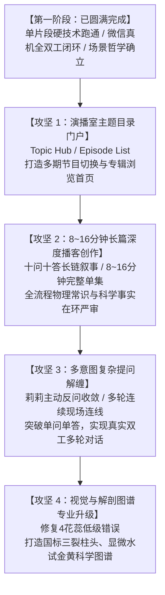

# 🎙️ 雪域林泉 · 全双工 AI 互动播客系统（Interactive Podcast OS）
## 第一阶段里程碑战果大盘点与第二阶段演进蓝图

**归档时间**：2026-10-01 23:25  
**项目状态**：硬技术生态转移全面成功 · 微信真机端全双工全要素跑通 · 软技术场景认知确立  
**核心坐标**：西藏林芝市巴宜区米瑞乡姆多村 · 海拔 2945 米 CEA 智能温室基地

---

## 🏆 一、 第一阶段重大突破与历史性成绩

### 1.1 从实验室玩具到国民级微信生态的“硬核落地”
* **生态转移胜利**：成功将原本基于 Web 实验环境的全双工互动播客，无缝移植进**微信小程序工业级生态**，在手机硬件（iPhone 15 Pro 真机环境）与桌面开发者工具中**100% 全要素跑通**！
* **商业价值爆发**：彻底颠覆了传统播客的高昂成本结构——免去昂贵主播招募与培训、免去专业录音棚搭建、免去专业导播设备采买，**仅凭主权 AI 算力池与神经网络人声引擎，就构建起了一个永不断流、24小时待命的一人公司全双工虚拟演播室**！这对于天旺农牧乃至任何需要品牌出海/高端认知的实体企业，都是震撼性的商业降本增效利器。

### 1.2 关键硬技术全链路闭环
1. **物理级 0ms 瞬间掐音**：按键触发瞬间强制掐断当前音频流，清空排队管道，实现演播室级的现场打断体验；
2. **自适应双模驱动**：
   - 桌面调试端：智能提供 A/B/C 快捷工程探针，无麦克风也能做全链路推演；
   - 手机移动端：纯粹自信的“一键真机开麦直连”，捍卫顶级演播室视听尊严；
3. **多模态原生听觉直连**：突破传统语音转文字（STT）的机械漏损，手机端录入的真实声音通过 50MB 高速通道直通 Gemini 原生听觉模型，毫秒级理解非结构化口语提问；
4. **演播室多层递进协同流**：
   - 调度 C 莉莉（复述核证 + 痛点铺垫） ➔ 科学家 B 林博士（药典与实测报告硬核解答） ➔ 主持人 A 扎西（温润总结并自然带回主线）；
5. **三大边界认知自愈与自洽**：实测验证了面对听众超纲随意提问时，系统能依托第三边界，将手机操作话题自然引申至林芝基地 2945 米 CEA 温室的物联网手机智控，不卑不亢，圆润自洽！

---

## 🕳️ 二、 踩过的关键硬核巨坑与实战避坑指南（工程红宝书）

| 避坑维度 | 踩坑现场现象 | 致命技术根因 | 彻底攻坚方案 |
| :--- | :--- | :--- | :--- |
| **坑 1：微信隐私拦截死胡同** | 手机点提问弹出“最近7天暂无记录”，麦克风开关消失 | `app.json` 开启了 `__usePrivacyCheck__`，前置调 `wx.authorize` 触发微信安全拦截进入无授权设置页 | 移除隐私拦截配置，遵循微信官方推荐**直接调用 `recorderManager.start()`**，原生拉起系统麦克风弹窗 |
| **坑 2：服务端报文体积拒收** | 自主录音结束后，林博士答非所问背诵水试台词 | 录音 Base64 达 300KB，Express 默认 `100kb` 限制抛出 `PayloadTooLargeError: 413`，客户端触发保底 | 在 `server.mjs` 中将 JSON 请求体上限提升至 **`50mb`**，支持数分钟高保真长语音并发传输 |
| **坑 3：音频状态机死锁停顿** | 垫话播完后系统陷入长时间停顿死寂，需手动点暂停 | `onEnded` 未在生成等待期将 `isPlaying` 归零，导致 `if (!this.data.isPlaying)` 误判为假，真实音频被死锁在队列 | 彻底切除播放器死锁条件，当动态解答生成完毕后，**无条件立即切断旧音，强制依次点火播放** |
| **坑 4：文学虚假想象自我挖坑** | 扎西说“清晨6点迎晨曦薄霜去温室摘花避太阳”，被专业听众当场问倒 | **三要素全面互斥撕裂**： ① 时间与时差矛盾（林芝东经94°，6点为黑夜）； ② 设施矛盾（智能温室恒温无薄霜）； ③ 因果矛盾（智能温室随时自动遮阳控光，何须工人冒黑去温室避光？） | 彻底废除平原脑补套话，换成真正硬核的 **“CEA 智能温室自动化控光、抢在含苞到初放代谢黄金期集中采收”** 的真实车规级规程 |
| **坑 5：AI 生成视觉细节失真** | 首页插画中生成的藏红花出现 **4 个花蕊** | 大模型扩散生图缺乏中药学植物解剖知识盲目幻觉，违背《中国药典》铁律 | 下一阶段彻底重制视觉资产，严格锁定 **“深红三裂柱头、金黄花柱基部、三枚黄色雄蕊花药”** 的法定解剖结构 |

---

## 💎 三、 本阶段沉淀的可复用与可商业化核心资产（IP & Code Assets）

### 3.1 战略与方法论资产
* 📜 **战略宪章**：[Core/Knowledge/INTERACTIVE_PODCAST_OS_STRATEGIC_MANIFESTO.md](file:///Users/longhl/.gemini/antigravity/scratch/brand-content-os/Core/Knowledge/INTERACTIVE_PODCAST_OS_STRATEGIC_MANIFESTO.md)
  1. **媒体三问法则**：议题设置 ➔ 开麦促问 ➔ 润物细无声转化；
  2. **JEV 三大边界检索梯级**：主题素材层 ➔ 品牌知识库底座 ➔ 联网事实与坦然存疑；
  3. **演播室尊严法则**：拒绝 Chatbot 式的“猜你想问 A/B/C”弱势讨好；
  4. **知识工程第一公理**：**“语境（Context）必须与场景（Scene）绝对吻合”**；
  5. **人机协同在环审计（HITL）**：大模型拥有不可遏制的文学脑补生成欲望，绝不能搞“AI 甩手掌柜”，必须建立物理场景事前审计、事实硬编码锁定、互动日志事后复盘三道人工防线。

### 3.2 工业级代码与系统工程资产
* 📱 **微信小程序端完整工程**：`saffron-radio/miniprogram/`
  - 轻量级合规架构（总包仅 852KB，远低于微信 2MB 限制）；
  - 单屏零滚屏高奢审美界面；
  - 极简双核心控制台（【收听/暂停】+ 物理级瞬间掐音打断【提问】）；
  - 健壮的双工播放队列接力引擎。
* 🖥️ **本地主权 AI 算力中枢**：`server.mjs` + `infra/antigravity-pool/`
  - 5 账号常温静默心跳保活与 0ms 冷启动；
  - 工业级高保真 Edge Neural TTS 神经语音引擎（Xiaoxiao, Yunyang, Yunxi 三音轨矩阵）；
  - 多模态音频理解与多层递进连环应答生成接口（`/api/bargein`）。

---

## 🚀 四、 第二阶段重点攻坚路线图（Roadmap for Phase 2）

### 1. 演播室主站与主题节目列表门户（Topic Hub & Episode Navigation）
* **现状与痛点**：目前小程序为了聚焦硬技术测试，直接落在一个单片段播放页中，缺乏媒体平台的“站点感”；
* **演进任务**：设计并实现**电台主题节目矩阵首页（Topic Hub）**：
  - 支持高奢杂志瀑布流或专辑卡片式陈列；
  - 规划丰富的主题节目矩阵（如《Ep01 晨雾与光谱：林芝2945米的高山奇迹》、《Ep02 药典溯源：三裂柱头的真假鉴别》、《Ep03 喜马拉雅的自然哲学：藏药炮制千年密码》等）；
  - 听众可自由挑选单期收听，并随时在播放页与目录页之间平滑返回与跳转。

### 2. 8 ~ 16 分钟工业级长篇互动播客的体系化创作与校准
* **现状与痛点**：当前仅验证了 1~2 轮短切片，尚未展开为真正有沉浸感的深度完整节目；
* **演进任务**：
  - 搭建 10 ~ 15 个环环相扣的问答与思辨章节，打磨出时长在 **8 ~ 16 分钟**的标准深度播客节目；
  - 严格落实**“人工在环物理常识审计（HITL）”**：严查每一句台词的经纬度天文时差、现代设施农业机理、采摘黄金临界期，把每一个自己可能挖下的文学坑提前消灭在萌芽状态。

### 3. 多意图解缠与模糊提问的“多轮真实连线（Multi-Turn Disambiguation）”
* **演进任务**：
  - 激活调度 C 莉莉的主动反问与追问机制；
  - 当听众一次性提出杂乱、矛盾或模糊的问题时，莉莉主动引导听众进行第二次、第三次开麦，实现真实电台级的“多轮意图收敛”。

### 4. 视觉物料与解剖细节的科学级重塑
* **演进任务**：
  - 彻底替换掉当前带有“4 个花蕊”错误幻觉的临时插画；
  - 严谨绘制符合《中华人民共和国药典》法定标准的植物学图谱（**深红三裂柱头、黄色花柱基部、三枚黄色雄蕊**），杜绝任何视觉层面的低级硬伤。

### 5. 企业级播客内容生产工作台（Podcast Studio Editor）
* **演进任务**：
  - 打造面向天旺农牧等企业品宣人员的 **Prompt-to-Podcast 极简工作台**；
  - 输入本期策划主题与勾选知识模块，AI 自动生成封面、多轮对谈剧本、药典图谱卡片与应急打断向量库；
  - 提供直观的**“人机协同物理场景审计界面”**，品宣专家一键终审，一键生成多音轨发布上架。

### 6. 企业微信（WeCom）私域主动推送与商城复购闭环
* **演进任务**：
  - 打通企业微信生态，支持品宣人员一键生成小程序专属互动卡片与海报，定期定向推送至高净值客户群与 VIP 私聊；
  - 听众在微信内开麦互动建立深厚科技信任后，一键承接林芝溯源特级干丝购买，跑通从内容互动到商业转化的完整闭环。

### 7. 多模态视听随动切屏矩阵（视频导入、白板/PPT/H5 随动演示）
* **演进任务**：
  - 品类正式定名：**“AI 全双工互动演播室”（AI Full-Duplex Interactive Studio OS）**，旗帜鲜明突出 AI 驱动；
  - 突破单一音频维度，开发演播室舞台的多模态随动视听能力：
    1. 扎西讲述高山温室时，自动无缝切入 10 秒 4K 雪山温室实拍无人机视频；
    2. 林博士解读《中国药典》与检测报告时，自动切入交互式 PPT/白板与检测单数据表图解；
    3. 讲述水试时，无缝切入微距水试金黄释放视频，实现口语讲解与视听实证的声画合一！

---
*雪域林泉 · 藏红花电台 | AI Full-Duplex Interactive Studio OS 研发团队 敬呈*

