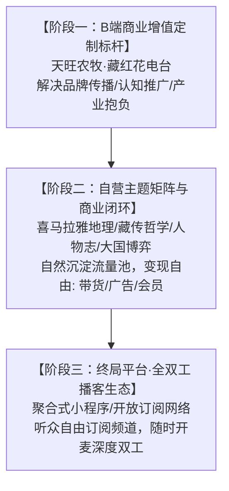
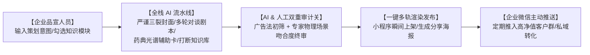
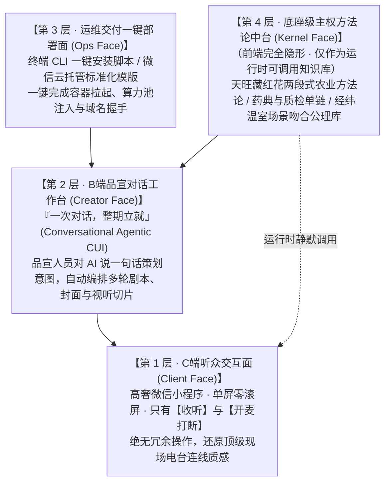
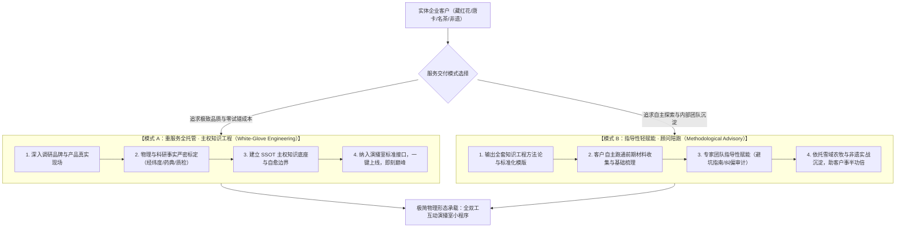
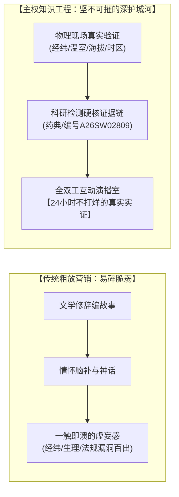

# 全双工 AI 互动播客操作系统（Interactive Podcast OS）战略蓝图与知识工程规范

**文件版本**：`v1.0 Strategic Manifesto`  
**核心定位**：基于微信小程序生态的、AI 深度驱导的、听众可随时深度双工互动的下一代互动式音频媒体平台  
**发布时间**：2026-10-01  
**归档目录**：`Core/Knowledge/INTERACTIVE_PODCAST_OS_STRATEGIC_MANIFESTO.md`

---

## 🏛️ 一、产品本质：剥离技术，回归新一代互动媒体

### 1.1 媒体本质论
剥离掉全双工、大模型与神经网络语音合成的技术外壳，本产品的商业本质是**“新一代深度互动式媒体平台”**。
技术永远只是分发与交互的载体；**议题的锐度、事实的精确度、叙事的审美感、解答的穿透力，才是媒体真正的地基**。

### 1.2 媒体三问法则（Agenda & Conversion Funnel）
1. **媒体第一问（议题设置）**：什么样的内容才能吸引人？
   - 拒绝企业自我吹嘘的广告软文；
   - 主动发起行业痛点与真相议题，制造认知反差与高密度认知增量；
   - 赋予内容高级的雪域风土审美与学者思辨品味。
2. **媒体第二问（开麦促问机制）**：什么样的抓手才能促成听众主动互动？
   - 在主线对谈中故意留下决策相关的认知钩子与悬念留白；
   - 营造专业、权威、被高度尊重的演播室对话场域（扎西文化官、林博士科学家、莉莉导播）。
3. **媒体第三问（润物细无声的转化）**：如何在互动中达成媒体传播与消费引导？
   - 绝不在互动中生硬推销；
   - 依托可核查的国家药典标准、第三方权威质检报告编号（如 A26SW02809）客观作答；
   - 用不可辩驳的科学实证占领受众心智，信任一旦确立，商业与消费引导水到渠成。

### 1.3 演播室尊严法则：拒绝客服式 Chatbot 的弱势迎合（Anti-Chatbot Dignity Protocol）
**核心审美定力：互动播客不是廉价的客服聊天机器人，必须维护专业演播室的沉浸感与审美尊严！**
- **心理模型区隔**：普通 AI 聊天工具生怕冷场，总在底部堆砌一排“猜你想问 A/B/C”——这是一种散发着廉价客服感的**弱势迎合型设计**；
- **听众心智假设**：愿意主动收听深度互动播客的用户，本身就是对物种、文化或产业抱有真诚探索欲与认知主动性的优质受众。当听众伸出手指按下【提问】的那一瞬间，他胸中必然有具体的疑惑、好奇或批判性思考，绝不可能“点了提问却不知道该问什么”；
- **真实连线尊严**：在面向用户的移动真机端，必须保持**“纯粹的一键开麦直连”**（0ms 掐断 ➔ 亮灯收音 ➔ 再次点击提交 ➔ 导播接话）。桌面端保留 A/B/C 仅作为无麦克风环境下的工程调试探针，面向大众的真实产品形态绝不搞多余的 A/B/C 提示，捍卫现场直播连线的真实感与高级感！

---

## 🗺️ 二、商业演进：从单点 B 端定制到矩阵化流量平台



1. **B 端商业定制轨（以天旺农牧为标杆）**：
   - 核心使命：为高客单企业提供行业认知推广与品牌战略服务，树立产业地位（如天旺“借地长球、归藏定质”两段式战略）；
   - 知识库围绕【品牌实体】与【产品实体】双轮驱动。
2. **自营流量与商业闭环轨（以人物志、地理科考、国际观察为代表）**：
   - 核心使命：通过高认知、强情绪价值、深度思辨的内容吸附高净值人群流量；
   - 变现方式完全自主：高端原产地特产带货、文创画册、付费会员、品牌赞助。
3. **终局平台（Interactive Podcast OS）**：
   - 用户在一个入口内自由订阅垂直频道的全双工播客，每个频道由专属 AI 专家团常驻，听众随时插话连线。

---

## 🏗️ 三、双轨知识中台标准作业程序（Two-Track SOP）

**战略铁律：建知识库与素材库是开辟任何新互动播客不可逾越的绝对基建！没有知识库，大模型就是空中楼阁。**

| 建设维度 | B 端商业定制轨（以天旺藏红花为例） | 自营流量闭环轨（以喜马拉雅人物志为例） |
| :--- | :--- | :--- |
| **核心服务目的** | 企业产业地位确立、品牌战略叙事、消费信任 | 破除现代人精神内耗、激发探索欲、沉淀流量 |
| **研究对象本质** | 土地与自然孕育的实体物种 + 企业品牌 | 历史坐标中的具体人物、重大命运抉择、口述档案 |
| **知识模型拓扑** | ① 品牌战略与愿景（两段式现代农业）<br>② 真实产地坐标（林芝米瑞乡智能温室 2945 米）<br>③ 鲜花精选得丝比（约 100 朵鲜花/克干丝）<br>④ 权威检验报告链（A26SW02809，39项零农残）<br>⑤ 国家药典与四部医典法定标准 | ① 时代风云与生存困境<br>② 极端命运抉择与生死瞬间（戏剧冲突）<br>③ 私密日记与信件口述档案<br>④ 人物精神遗产与现代心灵投射<br>⑤ 关联藏地文创与游学路线承接 |
| **红线阻断机制** | 严禁夸大未获批药效（如抗癌、治痴呆）；严禁将温室控环等同于零农残 | 严禁封建玄学神化；严禁未经核实的历史民间谣传 |

---

## ⚖️ 四、JEV 决策裁决与三大边界梯级检索法则

当听众开麦提问时，演播室必须严格执行不可逾越的三层边界检索预案，严禁 LLM 自由发散：

1. **第一层边界【当前主题素材层】**：
   提问若属于本期播客正在探讨的素材范畴，直接提取本期对谈既定事实作答。
2. **第二层边界【品牌/垂直知识库底座】**：
   超出本期话题但属于该频道知识库范畴，调取知识库权威实证（药典、检验单、经典文献）作答，绝不捏造任何不存在的科研所或数据库。
3. **第三层边界【外部联网核验与存疑预案】**：
   超出知识库时启动外部联网获取事实：
   - **预案 A（查无确证）**：**坦然承认**（*“抱歉，您的问题触及了我们目前的知识盲区，我们严谨治学、绝不信口开河，请您换一个问题”*）；
   - **预案 B（查有结果但与知识库冲突）**：**必须明确向听众声明**（*“这是外部网络检索的信息，与我们的基地标准/国家药典存在差异，仅供参考”*）；
   - **预案 C（查有结果且与知识库不违背）**：客观由林博士或扎西陈述。

---

## 🎙️ 五、演播室互动艺术：多层递进连环垫话与无限流流转

1. **0.1 秒秒级破冰垫话**：
   听众点击发送瞬间，导播莉莉在本地以 0.1s 极速开口接住场控，彻底消除后台网络等待的空白死寂。
2. **多层递进演播室流程**：
   - 莉莉【复述核证听众提问】 ➔ 莉莉【生活视角分析与痛点铺垫】 ➔ 林博士【药典与实测硬核解答】 ➔ 扎西【温润总结并自然带回主线】。
3. **无限电台章节流转**：
   互动解答完毕后，顺畅接回主线电台的下一个章节，生生不息，无限循环。

---

## 🔬 六、真实产业场景与物理地缘常识对齐法则（Physical Reality & Scene Calibration）

**核心铁律：拒绝文学虚假套话，杜绝场景错配；真知来源于真实车间、真实地缘与真实物理规律！**

### 6.1 经典警示案例剖析：藏红花采收的文学修辞 vs. 现代设施农业实证
* **典型失真表述**：*“采花工人们每天清晨6点迎着晨曦与薄霜前往温室大棚采摘，避免阳光直射破坏药效...”*
* **硬伤一【天文地理太阳时差失真】**：
  西藏林芝地处东经约 94.4°，与东经 120°（北京时间）存在近 **1.5 ~ 2 小时的太阳时差**。10月~11月藏红花花期，林芝当地日出时间在北京时间 **07:35 ~ 07:55** 左右。清晨 6:00 的林芝处于完全漆黑的长夜中，**根本没有晨曦**！这是典型的“平原作者闭门造车套用高原”的文学通病。
* **硬伤二【现代设施农业（CEA）与传统露天的场景错配】**：
  天旺基地是海拔 2945 米现代化的 **CEA 智能日光温室**。
  - 传统露天种植因无法控光，才需要赶在强日照前采摘，防止强光热将番红花苷加速降解为番红花醛；
  - 但 CEA 智能温室配备了自动化外遮阳、内保温幕布与物联网环控系统，温室本身就是精准控制光照和温湿度的！工人们根本无需摸黑去温室“躲太阳”，否则投资千万的智能温室便成了摆设。
* **硬伤三【真实采收生物学核心窗口的“主次因”颠倒】**：
  在藏红花采摘的真正植物生理学中：
  - **最核心的主要原因（Primary Factor）**：花丝最佳采摘窗口极短，必须在**花朵“含苞待放”到“刚刚盛开”、尚未触碰“开谢临界点”之间的极窄窗口期**！这个时刻是整朵花花丝、花柱内部番红花苷、苦素等活性营养成分**最稳定、最巅峰的黄金时刻**。一旦花朵越过临界点走向凋谢，高活性成分会迅速失衡、衰变或转化挥发；
  - **次要辅助原因（Secondary Factor）**：才是避免雄蕊花药爆裂、黄色花粉散落污染雌蕊红色花柱。

### 6.2 软技术与硬技术的本质区隔
在整个全双工互动演播室系统（Interactive Podcast OS）中：
* **硬技术（Hard Tech）**：全双工物理掐音、并发多线程神经网络人声（TTS）、大模型网络吞吐、微前端组件渲染——**这是系统的骨架与输送管道**；
* **软技术（Soft Tech）**：经纬度地理时差（林芝东经94.4°真实日出）、节气物候、现代智能温室设施工程、物种植物生理学临界窗口的**多维综合科学研判**——**这是系统的认知血肉与核心灵魂**！

### 6.3 知识工程最高底层铁律：语境（Context）必须与场景（Scene）绝对吻合！
大模型技术最容易犯的低级错误，是陷入纯粹的“文本语境（Textual Context）”自圆其说，而彻底脱离了现实车间的“物理场景（Physical Scene）”：
* **不是纯粹的语境自洽，而是【语境】必须与【真实场景】严丝合缝！**
* 任何脱离真实经纬度、脱离真实车间工艺、脱离真实植物生理临界期的随意文学性表达，都是对产业知识主权的背叛；
* 未来的垂直知识库工程，必须全面建立在“场景级物理审计”之上，确保每一句台词经得起天下所有专业人士的推敲。

---

## 🛡️ 七、人机协同双轨制：生成式内容的人工在环审计规范（Human-in-the-Loop Audit Protocol）

### 7.1 承认大模型的“生成欲望”与底层局限
大语言模型本质是概率密度与语意连贯性预测引擎。无论给它设定多少规则、行为模式或 Harness（脚手架约束），**大模型天然存在一种强烈的“自我生成与修饰欲望”**：
- 它为了语意的顺滑、辞藻的对仗、故事的文学美感，会下意识地调动互联网平庸语料进行自我脑补；
- 这种“生成冲动”往往以牺牲真实物理时空、真实农业设施工程、真实产业规范为代价；
- **纯靠机器审计机器、算法自我校准，永远无法根除细微但致命的现实偏差！**

### 7.2 人工专家在环审计（HITL）的三道硬核防线
在商业级全双工互动播客的生产全生命周期中，必须设立不可跨越的人工审计机制：

1. **第一道防线【主线广播资产·事前物理常识审计】**：
   - 播客主线台词绝不允许 AI 一键直出；
   - 必须由懂地缘天文（经纬度日出时差）、懂设施技术（CEA智能温室环控）、懂农学生物学（盛开临界窗口）的行业专家逐字做**“场景物理审计”**，消灭一切挖坑式文学套话。
2. **第二道防线【垂直知识中台·核心事实锁定审计】**：
   - 核心参数（如 2945 米海拔、检测报告编号 A26SW02809、约 100 朵鲜花出 1 克干丝）必须通过代码与数据硬锁死（Hard Constraints）；
   - 大模型在打断互动中只能充当“语言组织与播音表达器”，**绝无捏造事实或变动参数的特权**。
3. **第三道防线【听众互动日志·事后回溯进化审计】**：
   - 每日听众开麦提问与 AI 现场多层递进解答的完整录音及文字日志，必须每日进入专家复盘工作流；
   - 凡发现答非所问、盲目脑补或未吃透场景的回答，专家立即介入纠偏，并反哺写入知识库，形成人机协同的持续自愈闭环。

---

## 🎙️ 八、多意图交织与模糊提问的演播室收敛法则（Disambiguation & Multi-Turn Protocol）

### 8.1 真实听众连线的“大杂烩”心理常态
在全双工广播实战中，听众连线往往带着急迫与碎片化思维，常常在一句话中充斥着 3~4 个彼此交织甚至矛盾的意图（如“孕妇禁忌、美容养颜、每日克数、基地位置”同现）。
死板的 AI 会机械罗列导致长篇大论，而顶级广播演播室依靠**调度 C 莉莉**进行意图解缠：

1. **范式一【主次拆解 · 降维分流】（单轮解缠）**：
   - 优先识别生命健康与安全红线（安全禁忌 > 药典真伪 > 种植工法 > 日常冲泡）；
   - 莉莉以高情商台词为听众理清毛线团：*“这位朋友信息量很大，事关母婴安全，林博士先给您定死药典禁忌红线，稍后咱们再聊日常冲泡！”*
2. **范式二【温和反问 · 多轮收敛】（真双工二轮对谈）**：
   - 当意图严重冲突时，莉莉并不臆测，而是主动反问向听众发起第二轮开麦：*“演播室想帮您把最关心的核心解决掉——您最迫切想确认的是特殊人群禁忌，还是日常气血调理？按住麦克风告诉我，咱们有针对性地深聊！”*
   - 听众二次作答，演播室精准收敛，随后交给林博士定点爆破。

---

## 💼 九、企业级播客内容工作台与企业微信私域闭环（Enterprise Studio & WeCom Loop）

本产品最终交付给天旺农牧等 B 端实体企业的，不仅是一个前台小程序，而是一套**“企业级全双工互动演播室生产与私域运营闭环操作系统”**：



### 9.1 企业品宣工作台（Interactive Podcast Studio Editor）
交付给天旺品宣人员的标准化生产工作台：
1. **意图与知识模块勾选**：品宣人员无需懂技术，只需输入本期策划诉求（如*“第02期主打药典水试防伪，植入A26SW02809检测单，结合秋冬气血调理，时长12分钟”*），并勾选知识库模块；
2. **AI 全栈自动化生产**：
   - 自动生成受严格植物解剖 Prompt 约束的封面图（锁定深红三裂柱头与三黄色雄蕊，杜绝4蕊低级幻觉）；
   - 自动编排 10~15 轮扎西、林博士、莉莉的结构化对谈剧本；
   - 自动挂载相关的药典水试光谱图卡与应急打断向量库；
3. **AI 初筛 + 人工在环终审（HITL Gate）**：
   - AI 进行合规与广告法初检；
   - 品宣专家在后台界面核对台词的物理地缘吻合度（经纬度日出时差、智能温室控光、黄金采摘期），做最后的手工润色与确认；
4. **一键多轨渲染发布**：
   - 点击发布，后台多线程并发渲染高保真神经网络音频，小程序端秒级生效上线。

### 9.2 企业微信（WeCom）私域主动推送与商业变现闭环
* **高净值客户群主动触达**：
  天旺农牧通过企业微信沉淀了大量高客单老客与潜在加盟商。品宣团队可定期将新制作的一期互动播客小程序卡片主动推送到企业微信客户群、VIP 会员私聊；
* **双工互动促成深度信任**：
  客户在微信里点开即听，遇到任何价格、用法、真伪困惑随时一键开麦插话，演播室实时权威解答；
* **润物细无声的商城复购闭环**：
  听完林博士的硬核药典解答后，界面直接关联基地同款溯源特级干丝购买入口，完成从“内容收听 ➔ 开麦互动 ➔ 建立科技信任 ➔ 私域商城成交”的商业闭环！

---

## 🎥 十、产品定名与多模态视听随动演播矩阵（AI Studio & Visual Ingestion）

### 10.1 品类正式定名：必须旗帜鲜明突出“AI”力量
* **核心定名准则**：绝不能泛泛称为“全双工互动演播室”（容易被误解为传统电视台或昂贵的硬件设备集成商）；
* **官方品类定名**：**“AI 全双工互动演播室”（AI Full-Duplex Interactive Studio OS）**！
* **背书价值**：突出背后由生成式人工智能、主权大模型算力池、多模态原生听觉与神经网络人声共同铸就的“零真人主播、零高昂设备、智能自适应”的革命性科技力。

### 10.2 演播室多媒体随动切入矩阵（Dynamic Audio-Visual Ingestion）
真演播室绝不仅限于单一维度的口语对谈，屏幕中央舞台具备根据主持人台词**“智能随动多模态切屏与内容导入能力”**：

1. **实景视频动态切入（Video Ingestion）**：
   - 扎西讲述林芝米瑞乡 2945 米基地风土时，顶部画卷或全屏自动切入一段 10 秒高清航拍雪山智能温室短视频；
   - 林博士讲述水试实验时，自动切入花丝入水释放金黄云雾的微距慢动作实拍视频，视听合一，震撼力翻倍！
2. **交互式白板与 PPT 演示切入（Whiteboard & Slide Deck）**：
   - 当林博士引用《中国药典》法定标准与检测报告 A26SW02809 时，舞台自动滑出可双指放大查看的高清检测单长图、农残零检出数据表或紫外吸收光谱对比图表，以不可辩驳的视觉证据瞬间击穿受众心智；
3. **轻量交互 H5 与 3D 物体展示（Interactive H5 & 3D Object）**：
   - 允许切入 3D 藏红花植物模型交互（可 360 度旋转查看深红三裂柱头与黄色雄蕊），听众一边听林博士讲解植物学特征，一边在屏幕上亲手拆解花蕊，打造超越传统广播维度的未来级认知体验！

---

## 🏛️ 十一、最优产品物理与工程形态架构（Optimal Product Morphology）

针对未来向天旺农牧乃至各行业交付的商业化落地，系统确立**“四层解耦、外极简而内厚重”**的最优产品物理形态：



### 11.1 第 1 层：C 端听众交互面（Client Face）
* **物理形态**：超轻量微信小程序原生页面（包体积 < 1MB）；
* **设计哲学**：**克制、高奢、零负担**。用户只需要两个动作——【收听】沉浸在文化风土中；有疑问随时按【提问】开麦对谈；界面随动显示高清视频与检测单白板；
* **原则**：绝不把复杂的系统逻辑和设置项暴露给听众。

### 11.2 第 2 层：B 端品宣对话工作台（Creator Face）
* **物理形态**：对话式智能工作台（Conversational UI / Agentic CUI），拒绝充满几十个按钮的臃肿 CMS；
* **生产范式**：**“一次对话，整期立就”**：
  - 品宣人员在对话框输入：*“我想做一期关于林芝米瑞乡2945米药典指标与水试防伪的播客，结合深秋女性滋补，时长12分钟，植入A26SW02809检测报告”*；
  - AI 智能体在后台瞬间全自动完成：符合植物学三裂柱头的封面图、12分钟主持人多轮对谈剧本、微距水试与温室视频切片绑定、应急打断向量索引；
  - 界面提供可视化的一键审阅滑块，品宣专家审核确认后，点击【一键发布】瞬间同步到小程序端！

### 11.3 第 3 层：运维交付一键部署面（Ops Face）
* **物理形态**：Docker 容器化镜像 / 终端 CLI 一键安装脚本 / 微信云托管一键模板；
* **交付体验**：客户或技术支持人员在终端输入一行命令（`curl -fsSL ... | sh`），自动完成环境自检、主权算力池热凭据挂载与小程序服务拉起，彻底降维交付门槛。

### 11.4 第 4 层：底座级主权方法论中台（Kernel Face）
* **物理形态**：不可见的深度知识内核与原子资产中台；
* **定位实质**：这是企业最宝贵的技术与文化护城河（天旺农牧“两段式种植：借地长球、归藏定质”产业战略、《中国药典》水试光谱、A26SW02809检测单、经纬度日出与温室控环物理场景公理库）；
* **运行机制**：在小程序和前端页面中**完全不作显式展示**，仅作为小程序与大模型运行时静默调用的“主权决策与事实裁决知识底座”，从底层彻底捍卫品牌的科技真实性与话语权！

---

## 第十二章：“前台极简，前期重服务”——主权知识工程与实证交付双轨体系



### 12.1 商业与产品辩证法：表面极简，底座极重
* **外极简（Surface Minimalism）**：
  从物理形态看，产品给用户和客户展现的是极度轻量、自然流淌的听觉互动体验，或者一个“一次对话即可成型”的轻简发布工作台；
* **底座极重（Subsurface Gravity）**：
  在轻简界面的冰山之下，**前期的品牌深入调研、物理现实对齐与主权知识库建构是绝对不可或缺、也是最实在、最值钱的深地基**！
* **核心洞察**：
  没有深度知识工程的通用 AI，只是满嘴跑火车的文学玩物；唯有经过现场深度调研、实验室报告对齐、物理环境公理约束的 AI，才能成为高客单价非标产业的“数字化首席科学家与品牌总工程师”。一旦这个沉重、扎实的知识底座建构完成，接入演播室标准接口即可瞬间转化为生产力！

### 12.2 交付落地双轨制（Two-Tier Delivery Architecture）

#### 模式 A：全案重服务·主权知识工程深度赋能（Turnkey High-Touch Delivery）
* **定位**：针对高客单价、行业头部标杆客户（如大型农牧国企、国家级非遗画院、头部茶庄）。
* **实施路径**：
  1. **深度把脉与现场溯源**：深入企业种植基地/工坊，勘验生产流程、温室环控参数、质检报告链；
  2. **物理场景去伪存真**：剔除一切违背物理规律的文学套话（如日照时序、温差生理机制、国家标准合规）；
  3. **专家人设与知识图谱构建**：为企业量身定制 2~3 位具有真实学术背景与文化底蕴的虚拟专家人设，完成原子级向量切片；
  4. **标准化接口嵌入**：一键纳入全双工演播室接口，交付即投入实战，零幻觉、零翻车。

#### 模式 B：指导性轻赋能·顾问陪跑与方法论输出（Guided Self-Service / Advisory SaaS）
* **定位**：针对希望自主掌控内容生成流程、培养内部团队的创新型实体企业。
* **实施路径**：
  1. **自主探索与前期梳理**：客户团队自行收集原始材料、产品手册与品牌故事；
  2. **实战经验指导赋能**：我们提供独家沉淀的《品牌主权知识工程白皮书》与标准化 Prompt-to-Podcast 模版库；
  3. **雪域农牧与文化艺术实战底蕴支撑**：
     我们拥有从天旺农牧藏红花全产业链、西藏高原特色农产品、拉萨传统唐卡造像等一系列极其复杂、严苛的非标高价值行业中累积起来的血泪经验与知识建构心法。
  4. **“事半功倍”的护航价值**：
     由我们为客户提供定向指导性服务，能让客户绕过通用大模型的数万个致命大坑，用最短的时间、最低的试错成本，搭建出符合演播室标准的工业级知识库！

### 12.3 终极护城河公理：硬技术终将被迭代，唯有“从故事走向真实”的证据链重服务坚不可破



> **【战略断言与定海神针】**  
> 真正的硬技术（大模型算法、全双工通讯协议、流媒体架构、语音合成）随时可能被模仿、被超越、甚至被大厂更低成本的通用技术所替代。这是技术演进的大势所趋，任何单靠代码行数或接口工程叫嚣“技术壁垒”的想法都是自欺欺人。  
> 
> **我们坚不可破的终极护城河，正是前期做得很深、很重的那个前端服务环节——**  
> 1. **对客户品牌与物理现场的骨骼级梳理**；  
> 2. **对其主权知识库与科研证据链的无缝建构**；  
> 3. **带领客户彻底脱离“单凭编故事讲情怀的易碎营销”，全面升级为“依托物理事实与权威证据链的真实营销（Reality-Proof Marketing）”**！  
> 
> 故事可以被解构，谎言终会被戳穿，但**经过严格科研检测、符合自然规律、立足物理真实的科学与风土证据链，永不褪色**。这项深度重服务赋予了企业数字生命真正的灵魂与尊严，这才是竞品永远抄不走、替代不了的战略护城河。


---

## 🌐 十三、跨时空穿透式多对一并发架构（高并发分层解耦与降维漏斗）

### 13.1 现实场景挑战：从“单人独享”走向“千人同频”
当互动播客从小范围技术验证走向微信生态、公众号推广或朋友圈裂变时，面对的必然不再是单人独听，而是**“多对一”甚至“数千人对一”的群集并发场景**。
如果系统设计停留在“每位听众随意开麦，后端为千人同时提供实时 LLM + 独立 TTS 合成”的幼稚设想上，瞬时的算力洪峰与 API 限流（429 Too Many Requests）将在数秒内摧毁整个系统。

必须从**底层技术物理原理**出发，对高并发交互场景进行科学分层与降维解耦。

### 13.2 算力与通信的四级重量解剖

```
轻量级 (千人并发零压力，边际成本接近 0)
▲  [第一级] 基础主线广播流 (Edge CDN 静态分块 MP3) -------- 独立进度，0 服务端算力
│  [第二级] 穿透式弹幕网 (轻量 Pub/Sub 广播总线) ---------- 毫秒穿透，营造 100+ 人围炉感
│  [第三级] 精彩问答胶囊“一键旁听” (静态快照复用) -------- 核心破局点：1人计算，万人享用
▼  [第四级] 实时独立开麦插嘴打断 (ASR + LLM + 实时TTS) --- 物理核弹区，严禁无节制暴露
重量级 (若无漏斗防护，瞬间吞噬算力与成本)
```

1. **第一级（基础主线流）**：由客户端 `InnerAudioContext` 自主驱动播放与进度，音频分块部署于边缘 CDN，10人听与1万人听，服务端 CPU/内存开销均为 0。
2. **第二级（穿透弹幕网）**：文字弹幕、点赞与在线人数心跳，依托极轻量的 WebSocket/MQTT 消息总线，几千人并发仅需极低内存与微量带宽。
3. **第三级（共享问答胶囊旁听）**：将他人与 AI 互动的精彩结果沉淀为静态音频胶囊，其他听众旁听时直接读取 CDN，**零大模型消耗、零语音合成消耗**。
4. **第四级（实时私有打断）**：涉及语音流 ASR、千字上下文大模型推理与个性化 TTS。若无缓冲直接面临并发，GPU 显存暴涨、排队延迟恶化，全双工即时感荡然无存。

### 13.3 工业级破局四大法则（The 4 De-escalation Principles）

```mermaid
graph TD
    UserTraffic[1000 位在线听众群集互动] --> FunnelFilter{95/5 行为漏斗过滤}
    
    FunnelFilter -->|95% 围观/轻触意愿| ActionDanmaku[【文字弹幕 / 点赞 / 预设表情】<br>轻量 Pub/Sub 总线广播，毫秒级全网穿透]
    FunnelFilter -->|热问探索意愿| ActionEavesdrop[【一键旁听精彩问答胶囊】<br>读取已有 QA CDN 音频与预绑白板<br>★ 0 次大模型调用，0 次语音合成]
    
    FunnelFilter -->|5% 极少数语音打断| SemanticCheck{毫秒级语义指纹比对<br>Embedding Similarity > 0.88?}
    
    SemanticCheck -->|是 (80% 高频困惑)| DirectHit[【语义命中已有胶囊】<br>莉莉 0ms 垫音: '老李刚好也问了，我们听林工原声'<br>★ 避开深度推理，降维为静态播放]
    SemanticCheck -->|否 (全新深度问题)| DirectorQueue{导播台安全并发水位控麦<br>并发池 ≤ 8 路?}
    
    DirectorQueue -->|安全水位内| RealInference[【真实全双工推理】<br>ASR ➔ 知识库证据检索 ➔ LLM ➔ TTS<br>解答完毕自动固化为新 QA 胶囊广播入池]
    DirectorQueue -->|超出水位| BufferQueue[【导播排队垫音上墙】<br>莉莉优雅安抚: '已排在白板第2位，稍后接通'<br>听众掌控感满分，算力洪峰平滑吸收]
```

1. **法则一：【一次计算，千次消费】共享问答胶囊（Write Once, Read Everywhere）**
   - 听众老李问了“水变黄色是真的吗？”，系统仅消耗 1 次推理生成答复，随即固化为 `QA Capsule` 并生成金色弹幕；
   - 其余 999 位听众看到后点击 `[🎧 点击旁听]`，听到的是已固化的音频，看到的是联动白板——**把沉重的实时 AI 计算彻底降维成极低成本的静态 CDN 分发**。
2. **法则二：【毫秒级语义指纹去重（Semantic Deduplication）】**
   - 藏红花防伪等特定场景下，听众困惑有 80%~90% 是同质化的（孕妇能否喝、真假辨别、泡水颜色）；
   - 用户提问发起瞬间，先经过轻量向量检索。命中相似问答时，莉莉导播 0ms 提示“听众老张也问了同样的问题”，直接导流至已有解答，**瞬间削平 80% 的并发洪峰**。
3. **法则三：【导播台控麦与排队垫音（Director Floor Control & Buffer Audio）】**
   - 真实广播电台即使有 10 万人收听，也绝不允许 10 万个话筒同时接入演播室；
   - 导播（Lily）天然行使“控麦者”职责：设立安全并发池（如 5~10 路），超限时以真人语调温和垫音（“问题已记录在演播室白板，稍后接通”），让用户获得充分的被尊重感，而后端算力保持在绝对安全水位。
4. **法则四：【95/5 行为漏斗法则】**
   - 移动场景下，95% 的人是“围观型”、“轻触型”，喜欢看弹幕、点赞、一键旁听；真正开麦的只有 5%；
   - 只要把“文字弹幕互动”和“一键旁听热问”的体感做得足够丝滑、足够有围炉感，绝大多数人的互动渴望就已经被完全满足。

---
*本文件为 Brand Content OS 全双工互动播客产品的核心战略与技术宪章，后续产品迭代与多主题扩展均以此为准绳。*


