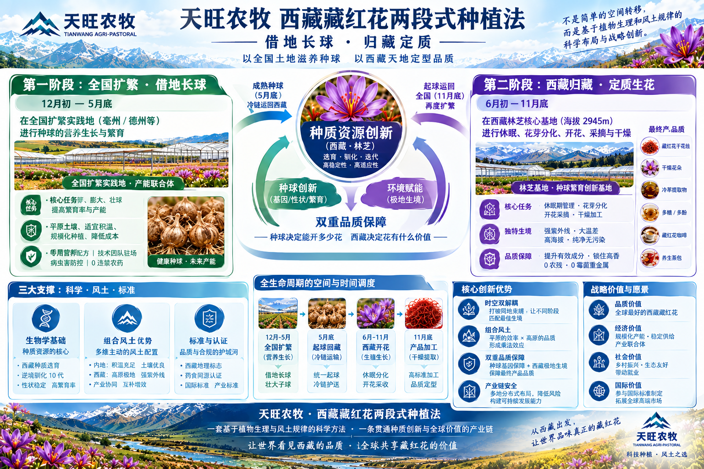
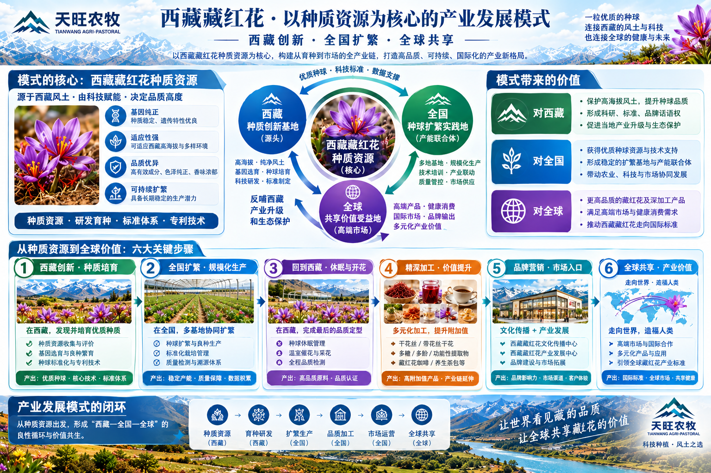

# KNO-8000 天旺农牧"西藏藏红花两段式种植法" —— 借地长球 · 归藏定质

> **Asset ID**: `KNO-8000` ／ module: `mod-kno` ／ 状态：Repository 正式资产（v1.0 定稿定义）
> **Ownership**: BRAND_OWNED（自研农艺方法与战略叙事，核心 IP）／ **Temporal**: CURRENT
> **Claim Control**: 方法论定义 = **CONFIRMED_FACT**（企业正式定义）；内部品质目标须挂证据链；**任何对外表述必须先过 JEV 红线**（见 §7）
> **定义日期**: 2026-09-27 ／ **术语演进**: 「借地长球、归藏定**型**」→「借地长球、归藏定**质**」（型→质，聚焦最终产品品质而非种球形态，演进记录见 §6）

---

## 〇、正式定义（Canonical Definition）

> **天旺农牧"西藏藏红花两段式种植法"：借地长球 · 归藏定质**
> —— 以全国土地滋养种球，以西藏天地定型品质。

其核心**不是**"把一个完整的种植过程拆到两个地方"，而是：

> **把藏红花不同生长阶段对环境的不同需求，与西藏和内地各自的资源优势进行精准匹配。**

**配套战略语言**（两句一上一下，构成天旺战略叙事的稳定核心骨架）：

| 层 | 语言 | 性质 |
| --- | --- | --- |
| 产业战略 | **西藏育种，全国扩繁，全球共享** | 产业战略 |
| 种植方法 | **借地长球，归藏定质** | 农艺方法 |

主视觉金句：**"种球决定能开多少花，西藏决定花有什么价值。"**

---

## 一、三层逻辑：三个问题彻底分开

### ① 西藏育种 —— 解决"种质基础"（种什么）

**西藏环境 × 天旺科技 → 优质种质**

在林芝进行持续的种源筛选、种球培育、技术迭代和数据验证，形成具有**高品质、高适应性、高稳定性、良好繁育潜能**的优质种质资源。

海报要素：选育·驯化·迭代（**逆向驯化 10 代**）；种球创新（基因/性状/繁育）× 环境赋能（极地生境）→ **双重品质保障**。

### ② 全国扩繁 —— 解决"规模产能"（有多少）

优质种球进入全国扩繁实践地（**亳州/德州等**），在适宜的土地、积温和农业条件下完成营养生长、分蘖和膨大。

**关键界定**：扩繁基地的任务**不是制造"西藏品质"**，而是把西藏形成的优质种质变成**足够数量的优质种球**。

> 主动的产业设计：西藏优质种质 → 全国扩繁 → 规模化种球资源 → 产业产能
> （把过去容易被理解成"西藏产能不足、不得不去内地"的被动关系，翻转为主动布局）

### ③ 归藏定质 —— 解决"最终产品品质"（品质高不高）

扩繁成熟的种球，在下一生产周期回到林芝，在西藏完成：

**休眠 → 花芽分化 → 开花 → 采摘 → 干燥**

最终形成：藏红花花丝、干燥花朵、冷萃提取物、多糖/多酚等深加工产品（延伸：藏红花咖啡、养生茶包）。

西藏此段承担的不是"把种球养大"，而是**利用西藏特有环境与天旺技术体系，让优质种球最终形成具有西藏品质特征的产品**。

---

## 二、全生命周期闭环（时间 × 空间调度）

```text
              西藏（种质创新与育种）
        环境 × 科技 → 优质种球（好种质）
                 │
                 ▼
   ① 全国扩繁（12月初—5月底，亳州/德州等）
      营养生长·分蘖·膨大 —— 解决"数量"
      平原土壤/适宜积温/规模化/专属营养配方
      技术团队驻场/病虫害防控/0 违禁农药
                 │
        5 月底 起球回运（冷链护送）
                 │
                 ▼
   ② 西藏归藏定质（6月初—11月底，林芝核心基地 海拔 2945m）
      休眠·花芽分化·开花·采摘·干燥 —— 解决"品质"
      强紫外线/大温差/高海拔/纯净无污染
                 │
        11 月底 产品加工（高标准加工）
                 │
                 ▼
      西藏藏红花产品（花丝·花朵·冷萃·多糖/多酚·咖啡·茶包）
                 │
        11 月底起球运回全国再度扩繁（循环重启）
```

**三大支撑**：科学（生物学基础/逆向驯化）· 风土（组合风土：内地积温+高原极地，互补增效）· 标准（西藏地理标志/药食同源认证/国际与产业标准）。

---

## 三、方法论主视觉（本资产双图）

| 图 | 文件 | 内容 |
| --- | --- | --- |
| A |  | 种植法全景海报：两阶段时间窗、种质创新枢纽、双重品质保障、三大支撑、战略价值 |
| B |  | 产业发展模式海报：种质核心三圈循环、六大关键步骤、对西藏/全国/全球的三层价值 |

---

## 四、从方法到产业：六大关键步骤（图 B 扩展）

| # | 步骤 | 关键动作 | 产出 |
| --- | --- | --- | --- |
| ① | 西藏创新·种质培育 | 种质资源收集与评价、基因选育与良种繁育、种球标准化与专利技术 | 优质种球·核心技术·标准体系 |
| ② | 全国扩繁·规模化生产 | 多基地协同扩繁、标准化栽培管理、质量检测与溯源体系 | 稳定产能·质量保障·数据积累 |
| ③ | 回到西藏·休眠与开花 | 种球休眠管理、温室催花与采花、全程品质检测 | 高品质原料·品质认证 |
| ④ | 精深加工·价值提升 | 干花丝/带花丝干花、多糖/多酚/功能性提取物、藏红花咖啡/养生茶包 | 高附加值产品·产业链延伸 |
| ⑤ | 品牌营销·市场入口 | 文化传播中心+产业发展中心、品牌建设与市场拓展 | 品牌影响力·市场渠道·客户体验 |
| ⑥ | 全球共享·产业价值 | 高端市场与国际合作、多元化产品与应用、**引领全球藏红花产业标准** | 国际标准·全球市场·共享健康 |

**产业闭环**：种质资源（西藏）→ 育种研发（西藏）→ 扩繁生产（全国）→ 品质加工（全国）→ 市场运营（全国）→ 全球共享（全球）。

**三层价值**：对西藏（保护高海拔风土；形成科研/标准/品牌话语权；产业升级与生态保护）· 对全国（优质种质与技术输出；稳定扩繁基地与产能联合体）· 对全球（更高品质产品；**推动西藏藏红花走向国际标准**）。

---

## 五、模块整合逻辑（Module Integration Map）

### 上游输入（本资产依托的数据与知识）

| 模块 | 资产 | 供给内容 |
| --- | --- | --- |
| DAT-4000 | CEA 全球基准 | 可控环境种植的国际横向参照 |
| EVI 证据链 | EVI-2026-A26SW02809（重庆食药检）、SMQ WT10103260183295WT2（深圳计量质检）、CMP-001（海关凭证） | "归藏定质"品质主张的实证锚点 |
| TER-3000 | 风土资产（GLOBAL_SAFFRON_TERROIR_MAP） | 组合风土的地理学依据 |
| KNO-BULB-1000 | 什么样的种球才是好种球 | ① 层"种质基础"的种球级细则 |

### 同层关联（Knowledge 内部）

| 资产 | 关系 |
| --- | --- |
| SAFFRON_CULTIVATION_METHOD.md（种植法演进 2026-08-19） | **本资产的沿革前篇**：记录西班牙种球→崇明试种→林芝双试种→定型两段式的演进史；本资产给出其 v2.0 正式定义与战略语言 |
| HOMECOMING_MASTER_FRAMEWORK | 归藏叙事框架（本方法是其农艺支柱） |
| KNO-7000 / KNO-7100 | 历史与人文纵深（叙事素材） |

### 下游消费（谁用它、怎么用）

| 消费方 | 用法 |
| --- | --- |
| **Core/Standards（STD 系列）** | ①② 两层的工艺条款 = 天旺**企标草案**的农艺正文；⑥ 的国际标准雄心对接 STD-6100 联盟战略 |
| COM 对外产出 | 官网 agronomy 页、品牌叙事（西藏育种，全国扩繁，全球共享）、政府汇报、投资人材料的**标准骨架** |
| PR Toolkit | "种球决定能开多少花，西藏决定花有什么价值" 等金句的表达母版 |
| mu / JEV 工具 | 术语卡（两苷一醛）+ 本资产的定义 = 判定与生成时的知识底座 |

### 触发问题（trigger_questions）

- 两段式种植法是什么？/ 为什么种球要去内地扩繁？
- 借地长球、归藏定质怎么理解？
- 西藏育种、全国扩繁、全球共享的战略含义？
- 全国扩繁会不会稀释西藏品质？（答：不会——扩繁管"数量"，归藏管"品质"，见 §1②）

---

## 六、术语演进记录

| 版本 | 表述 | 状态 |
| --- | --- | --- |
| 旧 | 借地长球，归藏定**型** | 已升格（"型"易与种球形态混淆）|
| **现行** | 借地长球，归藏定**质** | ✅ 聚焦最终产品品质 |
| 配套精炼 | 西藏育种：决定**种质基础** → 全国扩繁：形成**规模产能** → 归藏定质：形成**产品品质** | 三词定纲，避免种球品质与产品品质混谈 |

---

## 七、治理与使用纪律

1. 本资产为**企业方法论定义**（CONFIRMED_FACT），非对外宣称文本；
2. 内部品质目标（0 农残、0 霉菌重金属等）**必须挂证据链**（EVI/SMQ/CMP-001）方可对外使用；
3. 任何基于本资产的**对外话术，发布前必须过 JEV 红线**（`jev_claim_check`）——"绝对零农残"事件（2026-09-27 微信实拦）即为范例；
4. 扩繁基地表述禁用"西藏品质"字样——扩繁管数量，归藏管品质，这是本方法的定义级区分。
