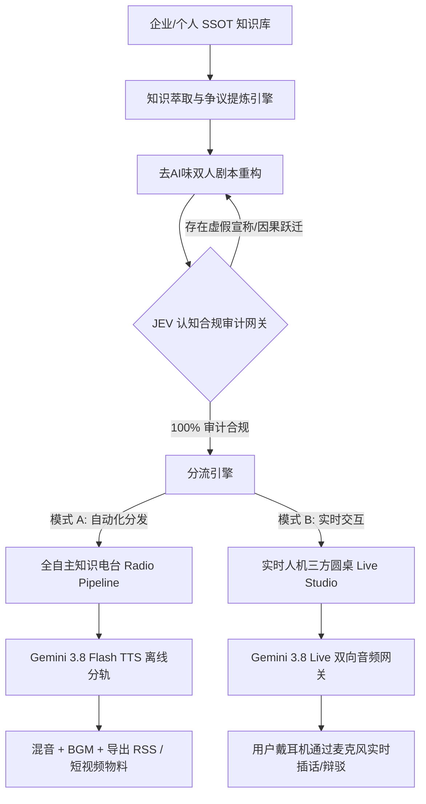

# 项目开发方案：NeoRadio (新一代主权交互式知识电台与合规播客引擎)
> **项目定位**：基于 **NotebookLLM 思维范式** 与 **Gemini 3.8 Live 原生声学引擎** 深度熔接的下一代音频系统  
> **核心标语**：*“比 NotebookLLM 多个麦克风（随时插话），比传统 AI 多个合规大脑（JEV审查）”*  
> **文档版本**：v1.0 (Draft for Architecture Review)  
> **日期**：2026-09-28  

---

## 一、 为什么要做？（背景与三大不可替代的破局点）

### 1. 行业现状与痛点
* **NotebookLLM 的惊艳与致命死穴**：
  * **惊艳点**：首创了双人互搏（Leo & Maya 风格）、反公文腔、将死板资料翻译为生活化口语的“去AI味”对话范式。
  * **致命死穴**：
    1. **只读黑盒（Non-interactive）**：纯单向广播磁带，听众无法插话，无法随时纠偏，缺乏真实交流感。
    2. **商业合规死穴（No Governance）**：生成内容不可控，大模型为了口语化经常“满嘴跑火车”，企业品牌因广告法和合规红线不敢用于正式宣发。
    3. **无工程化接口（No Headless API）**：只能在网页端手动拖拽、等待数分钟，无法融入自动化工作流。
* **Gemini 3.8 Live 的多模态破局点**：
  * 具备官方原生端到端声学能力（`gemini-3.8-flash-tts` / Live Bidi API）；
  * 原生理解情绪、呼吸、吞咽、笑声与打断，具有 24kHz 高保真原生人声（Aoede 灵动女声 + Puck 松弛男声）；
  * 拥有百毫秒级的双向流式通信能力，支持实时声学打断（Barge-in）。

### 2. 本方案的差异化价值（增量护城河）
将两者熔接，打造**“可插话的实时专家智囊团”**与**“商业级全自动合规播客生产线”**。

---

## 二、 双核心产品形态定义 (Dual-Mode Design)



### 形态 1：Interactive Live Studio（可中途插话的实时人机三方电台）
* **用户体验**：
  * 用户戴上耳机，后台挂载指定的长文档或整个知识库。
  * 两个 AI 主持人（Leo 负责宏观拆解，Maya 负责微观挑刺）在耳机里展开激烈的观点交锋。
  * **麦克风常开**：听众听到存疑之处，直接对着麦克风开口：“等等阿龙，你刚才提的那个种植成本到底是多少？”
  * **毫秒级物理打断（Barge-in）**：AI 立即停顿并收声，以自然口语回应：“哎，小林你先停下，这位朋友问到点子上了，关于这个成本……”
* **适用场景**：复杂财报深度研读、技术白皮书攻坚、投资尽调闭门研讨、深度学习伴读。

### 形态 2：Autonomous Compliance Radio（全自主商业级合规播客流水线）
* **用户体验**：
  * 全流程“无头化（Headless）”自动运行。
  * 一旦知识库中有新文档导入或日常巡检触发，自动提炼出 3~5 分钟的“微播客切片”。
  * 引入 **JEV 决策层** 进行机器级合规红线硬拦截，杜绝广告法违禁词与未证实药效宣称。
* **适用场景**：企业品牌知识传播（小红书/播客/微信公众号）、行业日报自动生成、企业内部培训晨报。

---

## 三、 系统整体技术架构 (System Architecture)

系统划分为五大核心层级：

```
┌─────────────────────────────────────────────────────────────┐
│ 1. 知识底座与状态管理层 (Knowledge & SSOT Layer)             │
│    - Markdown / PDF / 研报解析器                              │
│    - 7 级事实权属标记 (CONFIRMED_FACT / FORBIDDEN_ASSERTION) │
└──────────────────────────────┬──────────────────────────────┘
                               │
┌──────────────────────────────▼──────────────────────────────┐
│ 2. 认知剧本生成与 JEV 审计层 (Script & Governance Layer)       │
│    - 反 AI 八股剧本引擎 (强制口语破句、气口标签、垫词)       │
│    - JEV 本地红线检测器 (Noul 概率判定、因果解耦校验)        │
└──────────────────────────────┬──────────────────────────────┘
                               │
┌──────────────────────────────▼──────────────────────────────┐
│ 3. 声学导演与调度网关 (Acoustic Directing & Pool Layer)      │
│    - 多账号 API 池治理引擎 (Antigravity Pool, 429 智能轮转)  │
│    - 声学标签解析器 ([轻笑]、[叹气]、[短暂停顿] 物理参数映射)│
└──────────────────────────────┬──────────────────────────────┘
                               │
┌──────────────────────────────▼──────────────────────────────┐
│ 4. 原生音频渲染引擎 (Gemini 3.8 Audio Engine)               │
│    - 模式 A: models/gemini-3.8-flash-tts 批量 24kHz 分轨合成│
│    - 模式 B: Multimodal Live WebSocket 双向流式低延迟管道   │
└──────────────────────────────┬──────────────────────────────┘
                               │
┌──────────────────────────────▼──────────────────────────────┐
│ 5. 交互与交付终端 (Delivery & Interaction Interfaces)       │
│    - CLI 终端 (支持原生 afplay 播放与麦克风捕获)            │
│    - WebUI (基于 WebRTC / AudioWorklet 的流式交互界面)       │
│    - 播客 RSS / MP3 静态交付工场                             │
└─────────────────────────────────────────────────────────────┘
```

---

## 四、 核心技术攻坚点与解决方案

### 1. 声音双工与中途插话（Barge-in）的延迟控制
* **痛点**：传统串行链路（ASR -> 大模型思考 -> TTS）会导致用户插话后需要 2~3 秒 AI 才会停嘴，毫无真人交互感。
* **解决方案**：
  * 前端采用客户端轻量 **VAD (Voice Activity Detection)** 与回声消除 (AEC)；
  * 一旦检测到用户发声能量超过阈值，本地客户端立即暂停正在缓冲的 TTS 音频流（实现听觉上的“秒停”）；
  * 同时向 Gemini 3.8 Live WebSocket 发送中断帧 (`client_content` 附加打断信号)，将新一轮上下文焦点切换给用户输入。

### 2. 商业合规与口语化（去AI味）的动态平衡
* **痛点**：追求口语化容易导致大模型胡言乱语；追求合规又容易打回成“机器人念说明书”。
* **解决方案（JEV 双系统闭环）**：
  * **System 1 (决策拦截)**：JEV 本地适配器依据红线库进行逐句断言检测，如发现“根治疾病”、“绝对安全”等词汇，输出硬拒绝；
  * **System 2 (修辞变换)**：提示词告知模型：“在严格保持该事实（如水溶性类胡萝卜素能穿透血脑屏障）绝对准确的前提下，换用老北京或大白话聊天方式表达，严禁出现夸大断言”。

### 3. 多角色轮替的状态机维护
* **痛点**：单模型在没有强约束下容易自己跟自己聊乱、角色性格漂移。
* **解决方案**：
  * 引入显式角色状态机：
    * `Host A (Leo)` -> 绑定音色 `Puck`，设定为架构师/客观解构者视角；
    * `Host B (Maya)` -> 绑定音色 `Aoede`，设定为怀疑论者/大众体验官视角；
  * 剧本输出强制格式化为带角色标签的结构化切片，TTS 调用时按角色音色严格路由。

---

## 五、 项目实施落地路线图 (Milestones)

| 阶段 | 周期 | 核心目标 | 交付物 |
| :--- | :--- | :--- | :--- |
| **Phase 1: 核心链路验证 (PoC)** | **已完成 (Today)** | 验证 Gemini 3.8 Flash TTS 原生音频质量，跑通去AI味剧本与 Aoede/Puck 双音色拼接。 | `run_gemini38_pure_tts.mjs`，生成 40 秒高保真双人对谈样例。 |
| **Phase 2: JEV 合规闭环与 CLI 自动化** | **第 1 周** | 1. 接入 `jev-decision-layer` 进行台词合规机审<br>2. 支持直接传入本地 Markdown 一键生成整套播客文件。 | 命令行工具 `pnpm podcast --file <path>`，支持自动打合规标签与混音。 |
| **Phase 3: 实时可插话终端 (Live MVP)** | **第 2~3 周** | 1. 基于 WebSocket 打通 Gemini 3.8 Live 实时双向流<br>2. 支持 Mac 本机麦克风输入与即时声学打断（Barge-in）。 | 交互式终端程序 `pnpm live-radio`，戴耳机可随时插嘴对谈。 |
| **Phase 4: WebUI 工作台与播客发布** | **第 4 周** | 1. 可视化剧本编辑器（支持在播放前微调台词）<br>2. 自动配背景垫乐 (BGM)<br>3. 自动生成时间轴字幕并导出 RSS / 视频。 | 完整 Web 控制台，支持一键分发到小宇宙等播客平台。 |

---

## 六、 待讨论与技术评审问题 (For Peer Review)
1. **多模态 Live API 的长上下文计费与保活策略**：在持续 30 分钟的三方实时对谈中，音频流持续推拉的 Token 消耗与账号池如何最优分配？
2. **多语言与方言适配**：除普通话外，Gemini 3.8 原生 TTS 在方言口癖（如粤语、四川话或带地方调侃的中文）上的声学泛化能力边界？
3. **背景音乐（BGM）自适应避让算法**：在语音输出时 BGM 自动压低音量（Ducking），在思考停顿期间微弱垫起的本地混音实现方案。
