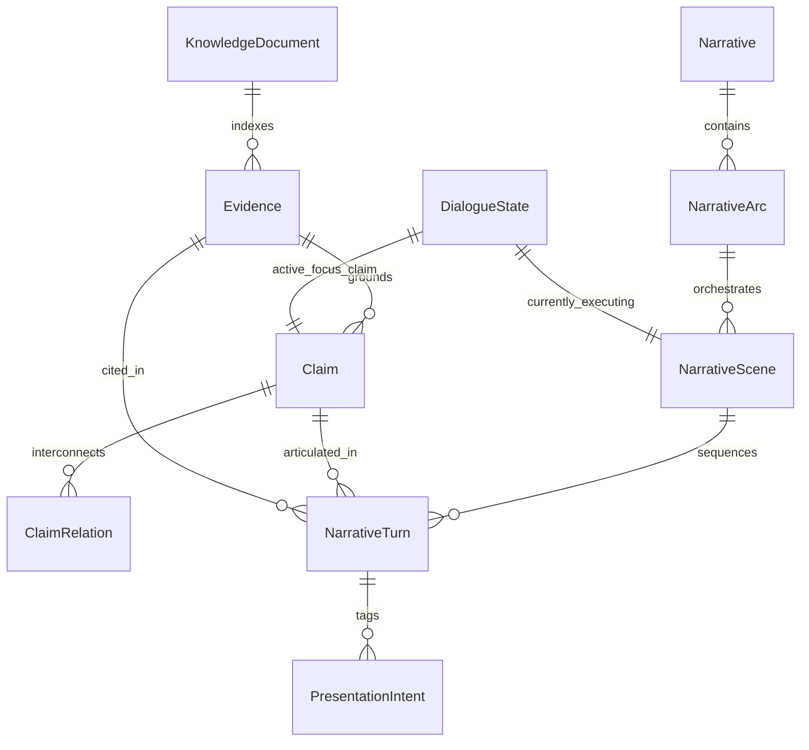

# NeoNarrative 核心领域模型设计规范 (Core Domain Model Specification)

**文件标识**: `ARCH-002-CORE-DOMAIN-MODEL`  
**核心版本**: v2.0 (Narrative IR & Media-Agnostic Upgrade)  
**关联规范**: `Core/Knowledge/V2_3_CLAIM_CONTROL_GOVERNANCE.md`  

---

## 1. 领域模型全景拓扑 (Domain Entity Relationship)

在 NeoNarrative 体系中，**`Narrative` 是认知层与呈现渲染层之间唯一合法的“中间表示（IR）”**。



---

## 2. 核心认知实体 (Cognitive Primitives)

### 2.1 KnowledgeDocument (知识底层 SSOT)
```typescript
export interface KnowledgeDocument {
  docId: string;                     // e.g., "DOC-STD-6000"
  title: string;                     // 文档标题
  version: string;                   // 版本号, e.g., "v2.3.1"
  docType: 'STANDARD' | 'LAB_REPORT' | 'WHITE_PAPER' | 'REGULATORY_FILE' | 'STRATEGY';
  authorityLevel: 'OFFICIAL_REGULATORY' | 'THIRD_PARTY_LAB' | 'ENTERPRISE_INTERNAL';
  uri: string;                       // 物理存储或可查阅 URI
  sha256: string;                    // 文档内容指纹，防止源文件静默篡改
}
```

### 2.2 Evidence (不可篡改的证据锚点)
```typescript
export interface Evidence {
  evidenceId: string;                // e.g., "EVI-LAB-2026-001"
  docId: string;                     // 关联文档 ID
  locator: {
    type: 'PAGE_PARAGRAPH' | 'TABLE_CELL' | 'CHART' | 'METRIC_FIELD';
    pageNumber: number;              // 所在物理页码
    sectionPath?: string[];          // e.g., ["§3 物理理化指标", "3.2 农残检测"]
    selector: string;                // e.g., "table[id='t-1'].row[2].col[4]"
    boundingBox?: [number, number, number, number]; // 视觉高亮框 [x1, y1, x2, y2]
  };
  rawQuote: string;                  // 原文一字不改的硬核引用
  metricData?: {                     // 结构化定量指标
    key: string;                     // e.g., "crocin_content"
    value: number;                   // e.g., 38.5
    unit: string;                    // e.g., "%"
    tolerance?: string;
  };
  confidence: number;                // 提取与校验置信度 (0.0 ~ 1.0)
  verifiedAt: string;
}
```

### 2.3 Claim (命题断言 —— 深度集成 V2.3 规范)
```typescript
export type ClaimLevel = 
  | 'CONFIRMED_FACT'        // 已确证事实：拥有权威第三方凭证
  | 'DERIVED_EXPLANATION'   // 合理衍生解释：科学推导，不得夸大为临床疗效
  | 'STRATEGIC_DIRECTION'   // 战略探索方向：企业规划，必须使用“探索/规划”句式
  | 'FORBIDDEN_ASSERTION';  // 严格禁止声明：违反红线、虚假或因果越界

export interface Claim {
  claimId: string;                   // e.g., "CLM-TECH-CEA-01"
  title: string;                     // 命题简述
  claimLevel: ClaimLevel;            // V2.3 核心权限分层
  canonicalAssertion: string;        // 官方标准陈述句 (SSOT 级)
  
  /**
   * 适用边界 (Scope) —— 杜绝个案被夸大为普适事实
   */
  scope: {
    spatial?: string[];              // e.g., ["西藏林芝", "海拔>=3000m"]
    temporal?: string;               // e.g., "2025年产季"
    targetEntity?: string[];         // e.g., ["一代特级种球"]
    boundaryConditions: string;      // 显式边界说明
  };
  
  evidenceAnchors: Array<{
    evidenceId: string;
    supportType: 'DIRECT_PROOF' | 'SUPPORTING_CORROBORATION' | 'STATISTICAL_SAMPLE';
  }>;
  
  /**
   * 因果解耦与红线约束 (Rule CC-01 & CC-02)
   */
  causalLinkage: {
    prerequisiteClaimIds?: string[];
    prohibitedInferences: string[];  // 禁止由此推导出的虚假结论
  };

  governanceRules: {
    allowedUsages: string[];         // 允许的表述模式
    forbiddenUsages: string[];       // 绝对禁止的表述模式
  };

  status: 'DRAFT' | 'AUDITED_PASS' | 'FLAGGED_WARN' | 'DEPRECATED';
}
```

---

## 3. 核心中间表示：Narrative (叙事核心对象 IR)

`Narrative` 是认知图谱转化为跨介质呈现的**核心枢纽**。它完整描述叙事骨架，但绝不出现任何具体的音频文件、声波频率或视频分辨率参数。

```typescript
export interface Narrative {
  narrativeId: string;
  knowledgeDomainId: string;
  title: string;
  version: string;
  
  /**
   * 叙事全局弧线 (Narrative Arc)
   */
  arc: {
    theme: string;
    exposition: string;              // 铺垫背景
    incitingIncident: string;        // 核心冲突引入 / 痛点抛出
    risingAction: string[];          // 观点辩驳递进
    climax: string;                  // 终极实证与真相大白
    resolution: string;              // 价值沉淀与总结
  };

  /**
   * 场景序列 (Scenes)
   */
  scenes: NarrativeScene[];
}

export interface NarrativeScene {
  sceneId: string;
  sceneIndex: number;
  name: string;
  sceneGoal: string;                 // 本场景叙事目标
  
  /**
   * 本场景激活的命题序列 (Claim Sequence)
   */
  claimSequence: Array<{
    claimId: string;
    roleInScene: 'PRIMARY_ASSERTION' | 'COUNTER_ARGUMENT' | 'RESOLUTION_PROOF';
    isCompulsory: boolean;           // 是否为核心必达命题（即使被打断也必须找机会讲透）
  }>;

  /**
   * 本场景的话轮规划 (Speaker Turns)
   */
  turns: NarrativeTurn[];
}

export interface NarrativeTurn {
  turnId: string;
  speaker: 'HOST_A' | 'HOST_B' | 'SYSTEM' | 'USER_PROXY';
  
  /**
   * 叙事意图 (Narrative Intent)
   */
  intent: 
    | 'PROPOSE_CLAIM'          // 提出新命题
    | 'CHALLENGE_CLAIM'        // 提出质疑与挑刺 (Host B 核心动作)
    | 'PROVIDE_EVIDENCE'       // 出具硬核凭证
    | 'QUALIFY_SCOPE'          // 澄清适用边界
    | 'HUMOROUS_RELIEF'        // 口语垫话与幽默调侃
    | 'USER_BARGE_IN_RECOVERY';// 从用户打断中平滑切回

  /**
   * 口语化表达模板（经 JEV 核准的去 AI 味语义文本，严禁八股文）
   */
  semanticUtterance: string;

  /**
   * 绑定的命题与证据
   */
  associatedClaimId?: string;
  citedEvidenceIds?: string[];

  /**
   * 介质无关的认知呈现意图列表
   */
  presentationIntents: PresentationIntent[];

  /**
   * 允许/禁止展开边界 (Guardrails)
   */
  boundaries: {
    allowUserDrillDown: boolean;     // 是否允许用户就此展开深挖
    forbiddenTopics: string[];       // 本话轮禁止延伸的话题
  };
}
```

---

## 4. 介质无关呈现意图模型 (Presentation Intent Model)

`PresentationIntent` 是介质解耦的关键。**它只定义认知呈现类型与语义载荷，不定义渲染介质。**

```typescript
export interface PresentationIntent {
  intentType: 
    | 'SPATIAL_CONTEXT'      // 空间地理位置认知
    | 'DATA_EMPHASIS'        // 关键数据定量认知
    | 'EVIDENCE_REVEAL'      // 原文凭证可信度展示
    | 'COMPARISON'           // 对比对撞
    | 'PROCESS_EXPLANATION'  // 工艺/机理演变
    | 'TIMELINE'             // 时序演变
    | 'QUOTE_SOURCE'         // 资质出处
    | 'CONCEPT_RELATION';    // 概念拓扑

  payload: {
    primaryText?: string;
    targetEntityName?: string;
    coordinates?: [number, number];  // 若为地理空间
    numericHighlight?: {
      label: string;
      value: number | string;
      unit?: string;
      baselineComparison?: string;   // e.g., "比传统露天高出3.8倍"
    };
    sourceReference?: {
      documentTitle: string;
      page: number;
      quote: string;
      verificationCode: string;
    };
  };
}
```

---

## 5. 会话上下文与运行时状态 (Dialogue Context)

```typescript
export interface DialogueContext {
  sessionId: string;
  activeNarrativeId: string;
  activeSceneId: string;
  
  /**
   * 当前焦点
   */
  focus: {
    activeSpeaker: 'HOST_A' | 'HOST_B' | 'USER';
    activeClaimId: string;
    speakingTurnId: string;
    startedTimestampMs: number;
  };

  /**
   * 用户打断与争议堆栈 (LIFO)
   */
  interruptionStack: Array<{
    interruptionId: string;
    userQueryText: string;
    intentType: 'INTERRUPT' | 'CHALLENGE' | 'DRILL_DOWN' | 'EVIDENCE';
    associatedClaimId: string;
    capturedAt: number;
  }>;

  /**
   * 状态机快照
   */
  stateMachine: {
    currentState: string;
    previousState: string;
    lastTransitionReason: string;
  };
}
```
