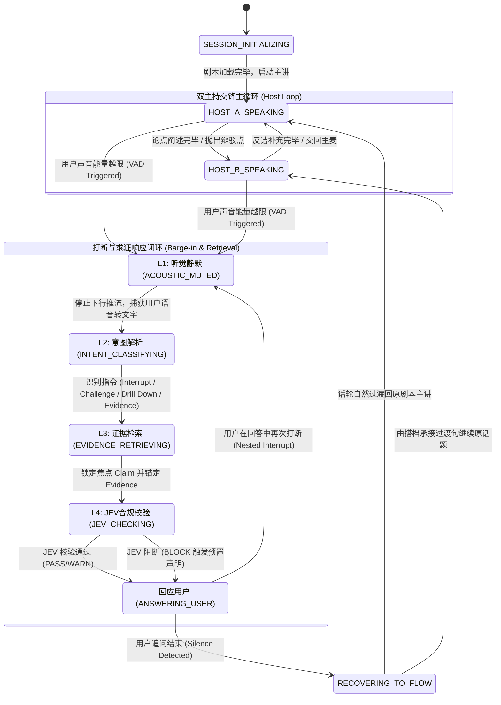

# 三方对话状态机与打断时序模型规范 (Dialogue State Machine Specification)

**文件标识**: `ARCH-004-DIALOGUE-STATE-MACHINE`  
**核心实体**: Host A (主讲/立论), Host B (搭档/反诘), User (听众/交互者)  
**核心使命**: 驱动实时多角色交锋，保证打断、求证、深挖时不出现死锁或角色漂移  

---

## 1. 状态机全景状态转移图 (State Diagram)



---

## 2. 状态节点详细说明 (State Definitions)

| 状态标识 | 描述 | 活跃主体 | 退出条件 / 守卫条件 (Guards) |
| :--- | :--- | :--- | :--- |
| `SESSION_INITIALIZING` | 加载目标文档、提取命题图谱、初始化双向通道 | 系统内核 | 资源就绪，首个 Claim 载入 |
| `HOST_A_SPEAKING` | 主持人 A 正在以宏观立论口吻阐述当前 Claim | Host A | 讲完该段、被 Host B 辩驳接管、或被用户打断 |
| `HOST_B_SPEAKING` | 主持人 B 正在挑刺、质疑、打趣或做具象补充 | Host B | 论点补充完毕、交还主麦、或被用户打断 |
| `ACOUSTIC_MUTED (L1)` | 本地秒级切断音频输出，消除回声干扰 | 客户端/音频引擎 | 用户持续发声结束，或静音超时 (800ms) |
| `INTENT_CLASSIFYING (L2)` | 解析用户语句意图与指令类型 | NLU / 决策网关 | 意图分类与槽位提取完成 |
| `EVIDENCE_RETRIEVING (L3)` | 寻找当前争议 Claim 的溯源证据 | 认知对象图谱 | 提取到目标证据或确认无凭证支撑 |
| `JEV_CHECKING (L4)` | 评估准备输出的回复内容合规性 | JEV 治理引擎 | 产生 PASS / WARN / BLOCK 裁决 |
| `ANSWERING_USER` | 主持人以设定的角色口吻正面回答用户 | 选定的 Host | 回答完毕且用户未继续追问 |
| `RECOVERING_TO_FLOW` | 组织“转场垫词”，平滑过渡回被打断前的原知识主线 | 选定的 Host | 生成转场语并激活被打断的下一个 Claim |

---

## 3. 分层打断延迟模型 (Barge-in Latency Pipeline)

打断绝不是简单地把扬声器静音，而是由四个层级严格协同的漏斗流水线构成的系统工程：

```
用户开口
   │
   ▼ t = 0ms
┌────────────────────────────────────────────────────────┐
│ L1: 听觉秒停 (Acoustic Cutoff)                         │
│ • 本地端侧 VAD 越限检测                                │
│ • 立即静音本地 PCM 播放队列 (秒停)                     │
│ • 发送 WebSocket 中断包 (cancel_turn) 到服务端         │
└────────────────────────────────────────────────────────┘
   │
   ▼ t <= 80ms (听觉感知停止)
┌────────────────────────────────────────────────────────┐
│ L2: 意图理解与指令分类 (Intent Classification)         │
│ • ASR 实时流转文字                                     │
│ • 极速意图识别：Interrupt / Challenge / DrillDown / Evidence │
│ • 确定本次回答应当由谁接麦 (Host A or Host B)          │
└────────────────────────────────────────────────────────┘
   │
   ▼ t <= 250ms (意图锁定)
┌────────────────────────────────────────────────────────┐
│ L3: 证据回溯与上下文定位 (Evidence Anchor Retrieval)   │
│ • 根据当前正在阐述的 activeClaimId 与用户语义          │
│ • 检索 Evidence 锚点 (页码、原文段落、数据)            │
│ • 组装 Prompt 提示包（含原文 quote 与权限级别）        │
└────────────────────────────────────────────────────────┘
   │
   ▼ t <= 400ms (证据装配就绪)
┌────────────────────────────────────────────────────────┐
│ L4: JEV 治理审查与首包合成 (Governance & First Chunk)   │
│ • JEV 极速裁决是否符合 CC-01 / CC-02 因果要求          │
│ • Gemini Live 吐出第一声（例如："哎，小林你先停一下…"） │
│ • UI 端同步派发证据弹窗事件                            │
└────────────────────────────────────────────────────────┘
   │
   ▼ t <= 800ms (听众听到主持人第一句回应)
```

---

## 4. 四类用户指令交互处理与分支策略 (Conversation Control)

系统支持用户通过语音或文本输入发出四种不同维度的控制指令：

### 4.1 指令 1: `Interrupt` (普通插话 / 垫话补充)
* **用户动机**：“等等，我插一句，这个确实是现在的行业普遍情况。”
* **状态机分支**：
  1. 当前说话的主持人收声；
  2. 另一位主持人以口语垫词接话：“对，这位朋友说到重点了……”；
  3. 迅速确认用户观点，话轮在 1 轮内自然切回原命题。

### 4.2 指令 2: `Challenge` (质疑挑刺 / 反方立论)
* **用户动机**：“阿龙你刚才说开花率达到 95%，但据我所知行业均值才 70%，你这数据有水分吧？”
* **状态机分支**：
  1. 状态机识别到对 `Claim.canonicalAssertion` 的信任度挑战；
  2. **调度策略**：指定 Host B（挑刺角色）接管：“哈哈，果然有行家提出来了！阿龙你别光报喜，把实验条件讲清楚！”
  3. 激活 `Evidence` 调取：检索到该 95% 数据来自特定温室密闭实验（`Scope` 限制）；
  4. Host A 补充澄清适用边界，绝不把个案扩大为行业常规，完成因果解耦。

### 4.3 指令 3: `Drill Down` (垂直深挖 / 底层细节)
* **用户动机**：“你刚才提到‘设施控环’，能展开讲讲到底控制了哪些环境参数吗？”
* **状态机分支**：
  1. 状态机在认知图谱中沿 `ClaimRelation (EXEMPLIFIES / DEPENDS_ON)` 向下一层级子命题下钻；
  2. 将当前 `activeClaimId` 压入 `interruptionStack` 堆栈；
  3. 切换子命题为主焦点，展开 2~3 轮深度解析；
  4. 细节阐述完毕后，从栈中弹出原命题，平滑恢复宏观讨论。

### 4.4 指令 4: `Evidence` (溯源求证 / 调阅原文凭证)
* **用户动机**：“拿出依据来！这段话出自哪份文件第几页？”
* **状态机分支**：
  1. 状态机不走自由生成，直接提取 `Evidence` 实体中的 `locator` 与 `rawQuote`；
  2. 触发 `EVIDENCE_REVEAL` 事件推往 Presentation Layer；
  3. **UI 动作**：客户端瞬间弹窗高亮原 PDF 扫描件或标准文档对应行；
  4. **声学动作**：主持人念出凭证编号：“没问题，您可以看屏幕，这段结论出自国家标准 STD-6000 第 12 页第 3 段”。

---

## 5. 防死锁与异常恢复机制 (Guardrails & Deadlock Prevention)

1. **嵌套打断栈深度限制（Max Stack Depth = 3）**：
   - 当用户连续追问深挖超过 3 层时，主持人将礼貌控场：“咱们已经聊得非常深了，为了把全貌讲透，我们先把主线的第三部分听完，待会圆桌环节再深入探讨。”
2. **静默超时自动恢复（Silence Auto-Resume）**：
   - 主持人回应完用户后，若用户在 $3.5\text{s}$ 内没有后续声音输入，状态机自动切入 `RECOVERING_TO_FLOW`，继续原剧本播放。
3. **角色抢话仲裁器（Turn Arbiter）**：
   - 任何时刻只允许一个音频轨道处于活跃下行状态；Host A 与 Host B 之间切换必须通过显式的 `HANDOFF` 信号握手，杜绝双声并发重叠。
