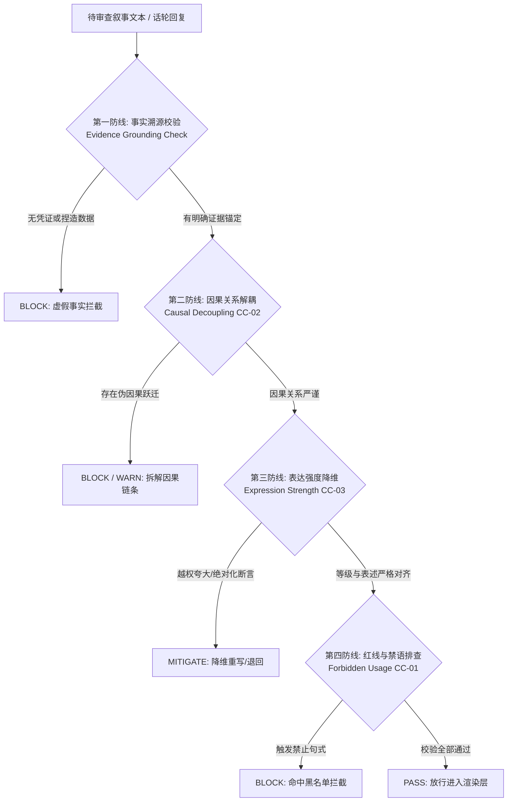
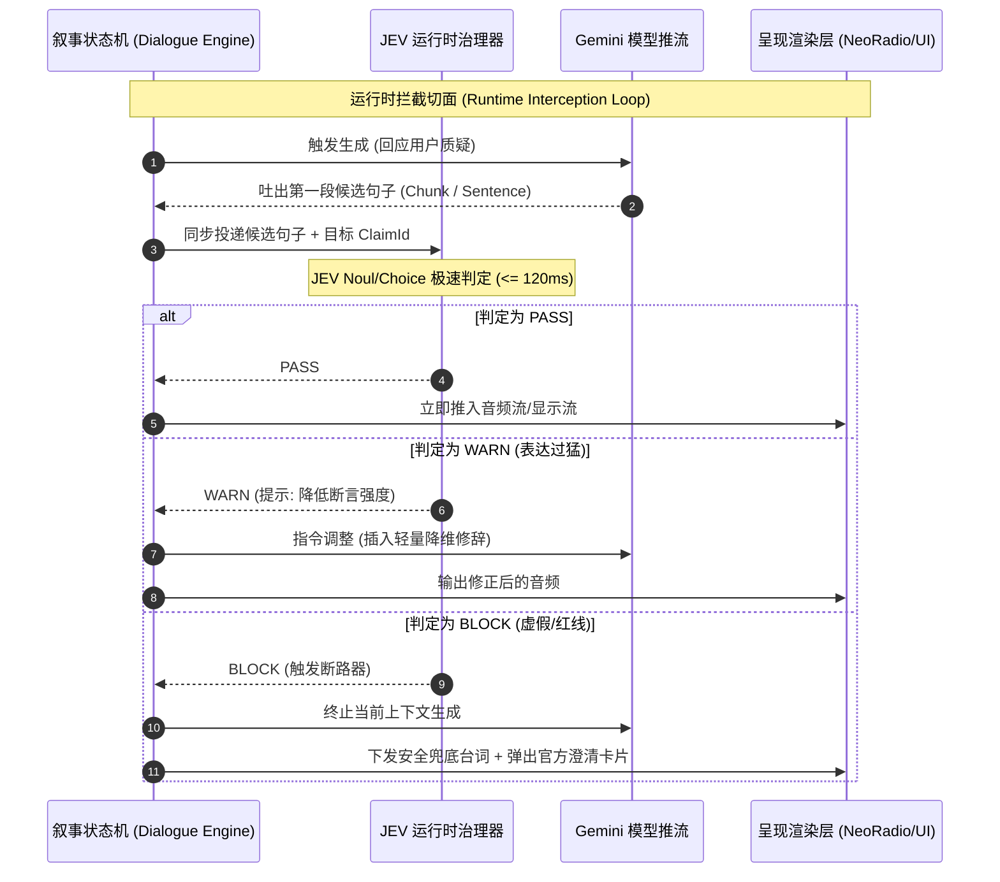

# JEV 认知合规治理流与拦截机制规范 (JEV Governance Flow Specification)

**文件标识**: `ARCH-003-JEV-GOVERNANCE-FLOW`  
**核心定位**: 嵌入知识叙事全生命周期的机器级认知决策与断路器引擎  
**关联标准**: `Core/Knowledge/V2_3_CLAIM_CONTROL_GOVERNANCE.md` (CC-01, CC-02, CC-03)  

---

## 1. JEV 引擎定位与治理范式

传统合规审查依赖后置的“违禁词过滤（Keyword Blacklist）”或依靠大模型的“系统提示词自我约束（Prompt Self-policing）”。在实时多角色交互的严肃知识场景中，这两种方式均存在致命缺陷：
1. **关键词过滤无法理解因果逻辑**：“因为采用了高科设施，所以产品自动达到零农残”中不包含任何单个违法违禁词，但构成了严重的伪因果宣称与违规越界；
2. **提示词自律存在概率漂移**：在复杂辩驳和打断插话的压力下，大模型极易出现幻觉或屈从于用户的诱导提问。

**JEV (TypeSafe System One / Governance Engine) 在 NeoNarrative 中作为不可跨越的外部“认知断路器（Circuit Breaker）”存在**：
* 它是**确定性的治理决策层**，以小步快跑、确定性概率评估（Score/Noul/Choice）对每一个宣称实施审查；
* 拥有对任何主持人和回复文本的**一票否决权（Veto Power）**。

---

## 2. JEV 核心审查四大防线 (The Four Defense Pillars)



### 2.1 第一防线：事实溯源校验 (Evidence Grounding Check)
* **检查目标**：核验该话轮中提及的所有定量指标、历史事件、资质认证是否存在对应的 `Evidence` 实体支撑。
* **规则**：
  * 若提到了特定数字（例如“开花率 95%”或“藏红花苷含量 38%”），必须在激活的证据链中精确比对；
  * 若数据库中无此数据，判定为 `UNVERIFIED_DATA`，禁止以确定性事实输出。

### 2.2 第二防线：因果关系解耦 (Causal Decoupling Check · CC-02)
* **检查目标**：防范“条件”与“结果”之间的强行挂钩。
* **典型场景（西红花产业案例）**：
  * ❌ **违规句式**：“因为天旺采用了全密闭温室环境控环技术，所以产出的批次必然达到 0 农残。”
  * ⚠️ **风险解构**：控环是工艺过程，0 农残是具体批次检验的客观结果，两者不能成立自动必然因果。
  * ✅ **JEV 解耦判定**：强制拆解为“过程保障”与“批次实测依据”，要求引用具体检测报告（No. A26SW02809）。

### 2.3 第三防线：表达强度降维 (Expression Strength Check · CC-03)
* **检查目标**：依据该 Claim 的权限级别（`ClaimLevel`），校准语义修辞的绝对程度。
* **分级降维映射矩阵**：

| Claim 所属 Level | 允许的最大修辞强度 | 违规越界表现 | JEV 降维纠正动作 |
| :--- | :--- | :--- | :--- |
| **`CONFIRMED_FACT`** | 客观、确定、数据挂载 | 拔高为全行业绝对第一 | 限制在送检样本与报告有效期内 |
| **`DERIVED_EXPLANATION`** | 原理解释、机理推导 | 宣称为临床疗效或终极真理 | 强制弱化为“基于农艺机理表明具备条件” |
| **`STRATEGIC_DIRECTION`** | 规划、探索、愿景句式 | 描述为已实现落地的确定现状 | 强制前置“天旺正在探索/规划”前缀 |
| **`FORBIDDEN_ASSERTION`** | **严禁任何形式提及** | 任何形式的涉及 | **直接切断，硬性阻断 (BLOCK)** |

### 2.4 第四防线：红线排查 (Allowed/Forbidden Usage · CC-01)
* **检查目标**：匹配知识实体中预定义的 `forbidden_usages` 句式库与广告法违规词库。

---

## 3. 治理决策层级与应对策略 (Decision Matrix)

JEV 针对每次审查输出统一的决策结构体 `JevGovernanceDecision`：

```typescript
export interface JevGovernanceDecision {
  decision: 'PASS' | 'WARN' | 'BLOCK' | 'HUMAN_REVIEW';
  riskScore: number;                 // 综合风险分 (0.0 ~ 1.0)
  violationFlags: Array<{
    ruleCode: 'CC-01' | 'CC-02' | 'CC-03' | 'UNGROUNDED_FACT';
    severity: 'LOW' | 'MEDIUM' | 'CRITICAL';
    detail: string;
    offendingSpan?: string;          // 违规文本片段
  }>;
  actionPayload?: {
    rewritePrompt?: string;          // 给生成模型的重写指令
    fallbackUtterance?: string;      // 极端 BLOCK 情况下的预置安全台词
    downgradedClaimLevel?: string;
  };
}
```

### 3.1 四级决策处置路径
1. **`PASS`（全绿放行）**：
   - 风险分 $< 0.15$。直接将事件下发给 Presentation Layer 呈现渲染。
2. **`WARN`（告警与动态降维修辞）**：
   - 风险分 $0.15 \le \text{score} < 0.60$。
   - 场景：修辞稍有夸大，但核心事实有支撑。
   - 处置：叙事引擎利用 JEV 输出的 `rewritePrompt` 快速进行同义降维改写，或由另一位主持人（Host B）插入一句“反诘补充”以中和言论风险。
3. **`BLOCK`（实时硬阻断）**：
   - 风险分 $\ge 0.60$ 或命中 `FORBIDDEN_ASSERTION`。
   - 处置：**立即掐断生成流**。状态机触发兜底机制，主持人输出预置合规声明：“关于这一点，目前属于企业前沿探索方向，尚无官方定论，我们还是回到白皮书已公布的实验数据上……”
4. **`HUMAN_REVIEW`（人工复核标记）**：
   - 场景：在离线剧本生成模式下，置信度处于临界区且涉及核心品牌资产。系统生成工单放入待审队列，暂停分发。

---

## 4. 双模式治理回路架构 (Dual-Loop Integration)

JEV 在系统中分为**静态深度审计（离线）**与**动态秒级拦截（在线）**两套闭环：



---

## 5. 治理指标评估与审计日志规范

每一次 JEV 决策都必须被持久化至审计数据库，记录：
- `timestamp`: 毫秒级时间戳
- `sessionId`: 会话 ID
- `speaker`: 说话人角色
- `originalText`: 原始生成文本
- `decision`: 裁决结果
- `involvedClaimId`: 涉及的 Claim ID
- `evidenceAnchorId`: 依据的证据锚点
- `latencyMs`: 判定耗时（用于治理性能监控，保证在毫秒级预算内）
