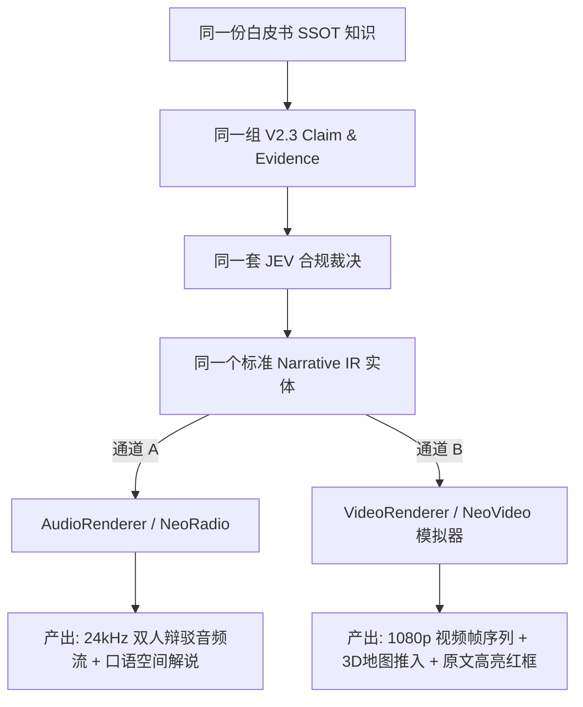
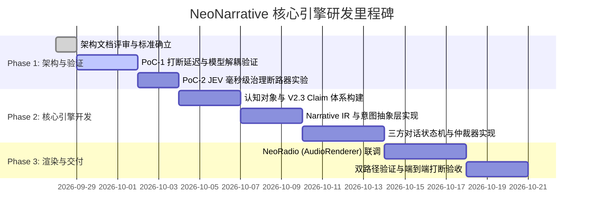

# NeoNarrative 技术验证 (PoC) 与 MVP 规划方案 (PoC & MVP Implementation Plan)

**文件标识**: `ARCH-005-POC-AND-MVP-PLAN`  
**核心目标**: 技术攻坚风险验证、Media-Agnostic 双路径验收标准与 MVP 1.0 开发边界界定  
**当前状态**: Approved / Architecture Review  

---

## 1. 核心架构检验两项铁律 (Core Architectural Tests)

在编写任何业务代码前，系统架构必须通过以下两项不可妥协的真实验证：

### 1.1 铁律一：“去掉 Gemini”反事实测试 (The "Remove Gemini" Test)

> **核心质问**：如果明天将 Gemini API 全部拔掉（替换为 Claude 3.7、DeepSeek-V3、本地 Llama 3 或自研推理引擎），NeoNarrative 还能剩下什么？

如果拿掉 Gemini 后系统只剩下一堆无用的调用脚本，则说明架构失败。**NeoNarrative 的资产构成边界如下：**

```
┌────────────────────────────────────────────────────────┐
│               NeoNarrative 核心系统主权资产             │
├────────────────────────────────────────────────────────┤
│ 1. SSOT 知识库与 Evidence 多维物理锚点图谱             │
│ 2. V2.3 Claim Control 四级断言权限与因果依赖网络       │
│ 3. JEV 机器级合规治理引擎 (CC-01/02/03 确定性裁决器)   │
│ 4. 介质无关的 Narrative IR 规范 (叙事弧/场景/呈现意图)  │
│ 5. 三方对话状态机 (Host A / Host B / User) 仲裁协议    │
│ 6. 统一 IRenderer 通用生命周期抽象契约                │
└────────────────────────────────────────────────────────┘
                           ▲
                           │ 可插拔适配器 (Pluggable Providers)
┌──────────────────────────┴─────────────────────────────┐
│ 外部无状态供应商 (随时可无痛替换)                       │
├────────────────────────────────────────────────────────┤
│ • Model Provider (当前: Gemini 3.8 / 备选: Claude / 自研)│
│ • Audio Bidi Provider (当前: Gemini Live / 备选: 本地) │
│ • Vector / Search Provider                            │
└────────────────────────────────────────────────────────┘
```
**验证结论**：NeoNarrative 是企业级知识叙事与合规引擎，Gemini 仅为第 6 层渲染器及外部推理的 Provider。替换 Gemini 只需重写 Provider 适配器，核心认知对象、JEV 决策逻辑与 Narrative IR **零行代码修改**。

---

### 1.2 铁律二：双路径验收测试 (Dual-Path Acceptance Test)

> **核心要求**：必须证明 Audio 与 Video 是同一个 Narrative IR 的不同 Renderer，而不是两套独立的内容生成系统。



#### 双路径验收标准规范：
* **输入一致性**：输入同一个包含 `SPATIAL_CONTEXT` 与 `EVIDENCE_REVEAL` 的 `NarrativeTurn`；
* **行为表现**：
  * **AudioRenderer**：主持人口语输出：“大家注意看西藏林芝海拔三千米以上的温室……依据第三方检测报告 A26SW02809，完全可追溯”；
  * **VideoRenderer**：视频画面在第 02.4 秒将三维镜头推向西藏林芝高原，并在右下角画中画自动弹出对应盖章检测报告扫描件并红框高亮；
* **测试判定**：在上述过程中，`Claim`、`Evidence`、`JEV Decision` 和 `Narrative` 保持绝对单一性，未针对 Video 重新让大模型写一篇所谓的“视频脚本”。

---

## 2. 关键技术攻坚实验设计 (PoC Experiments)

在正式开发前，需通过 3 个轻量 PoC 消除技术风险：

### 2.1 PoC-1: 全双工打断延迟测量实验 (Barge-in Latency PoC)
* **验证目标**：验证端到端打断流水线是否满足 $\le 800\text{ms}$ 的人类对话流畅阈值。
* **测量点与合格指标**：
  1. **L1 物理收声停音 (Acoustic Mute)**：从端侧麦克风检测到能量越限，到本地扬声器停止吐字：$\le 80\text{ms}$；
  2. **L2 意图识别 (Intent Classify)**：识别用户是否为质疑 (Challenge) 或求证 (Evidence)：$\le 250\text{ms}$；
  3. **L3 证据锚点加载 (Evidence Anchor Lookup)**：从内存索引中命中并组装当前 Claim 的 Evidence：$\le 100\text{ms}$；
  4. **L4 首包音频到达 (First Chunk Audio)**：AI 主持人第一句接话声音（如“小林你先停一下…”）开始播放：$\le 800\text{ms}$。
* **测试用例**：录制 10 段在 AI 阐述核心数据时的突发打断音频，记录 10 次时延分位数（P50, P90, P99）。

### 2.2 PoC-2: JEV 运行时快速拦截性能损耗实验 (JEV Latency PoC)
* **验证目标**：确保 JEV 运行时断路器介入对话流时，不引发长达数秒的“冷场尴尬”。
* **设计策略**：
  * 采用基于结构化决策模型（如 TypeSafe Jev Noul/Score 或紧凑判定模型），避免让通用大模型跑 2000 字的漫长 CoT 思维链；
  * 目标耗时控制在 $\le 120\text{ms}$。
* **测试用例**：注入包含伪因果（“控环所以0农残”）的违规文本，检验 JEV 是否在首包音频前完成判定并触发 `WARN/BLOCK` 重写。

### 2.3 PoC-3: 双角色声学平滑切换与上下文防漂移实验
* **验证目标**：Host A（稳健主讲）与 Host B（敏锐挑刺）在频繁交锋中，音色、语调与人物设定是否漂移，是否存在二人同时抢麦发声的物理冲突。
* **验证手段**：建立单轨仲裁调度器（Turn Arbiter），确保下行音频流具备确定性独占锁。

---

## 3. MVP 1.0 开发边界定义 (Scope & Boundaries)

为保证项目高效收敛，坚决不做发散性伪需求，严格划定第一阶段开发边界：

### 3.1  What We DO in MVP 1.0 (必须交付)
1. **SSOT 与认知图谱解析器**：
   - 支持标准 Markdown 白皮书与 PDF 检测报告的结构化解析；
   - 输出符合 V2.3 规范的 `Claim` 与带有页码段落坐标的 `Evidence`。
2. **JEV 合规治理网关 (Claim Governance Engine)**：
   - 实现 Rule CC-01（允许/禁止句式匹配）；
   - 实现 Rule CC-02（因果关系解耦判定）；
   - 实现 Rule CC-03（四级声明权限越界拦截）。
3. **介质无关的 Narrative IR 生成器**：
   - 生成包含完整 `NarrativeArc`、`Scene`、`ClaimSequence` 与 `PresentationIntent` 的标准 JSON/TS 数据实体。
4. **三方对话状态机 (Dialogue State Machine)**：
   - 驱动 Host A、Host B 的交替轮替；
   - 完整支持用户端发起 4 类指令（`Interrupt`, `Challenge`, `Drill Down`, `Evidence`）；
   - 实现 L1~L4 分级打断。
5. **首个落地渲染器：NeoRadio (AudioRenderer)**：
   - 基于双向实时 WebSocket（Gemini Live Bidi API 或 Flash TTS）实现低延迟 24kHz 声学渲染；
   - Web 客户端实现打断按键与麦克风 VAD。
6. **双路径验证模拟器**：
   - 实现一个轻量级 `VideoRendererSimulator`，验证同一 Narrative IR 在不修改的情况下，可被视频渲染器消费并打印画面关键帧指示。

### 3.2 ⚠️ What We DON'T DO in MVP 1.0 (坚决不做/延后)
* ❌ **不做全自动真三维视频实时渲染管道 (NeoVideo 工业版)**：MVP 仅输出 VideoRenderer 的数据契约验证器，不接复杂三维渲染引擎或 ffmpeg 编码集群。
* ❌ **不做开放式互联网无边界闲聊**：所有对话主题必须严格被限定在当前挂载的知识文档与 Claim-Graph 范围内，超纲问题一律由主持人礼貌驳回。
* ❌ **不做复杂的跨平台移动端 App 原生开发**：MVP 终端基于标准化 Web (HTML5/WebAudio/WebSocket) 交付，适配桌面与移动端浏览器。
* ❌ **不做多语种实时声学同传**：首期聚焦高质量标准中文交互。

---

## 4. 阶段里程碑排期 (Milestones Roadmap)



---

## 5. 验收检验清单 (Final Acceptance Checklist)

| 检验项 | 验收标准 | 验证方式 |
| :--- | :--- | :--- |
| **Media-Agnostic 检验** | `Narrative` 实体不包含任何采样率、声道、像素或视频轨硬编码参数 | 静态 Schema 审计 |
| **“去掉 Gemini”检验** | 将推理与声音模块 Mock 替换为开源组件，核心 Claim、Evidence、JEV、Narrative 保持 100% 正常运行 | 单元测试套件 |
| **双路径验证** | 同一个 Narrative IR 能够分别驱动 AudioRenderer 吐出台词与 VideoRendererSimulator 输出关键帧 | 跨渲染器回放脚本 |
| **打断与求证闭环** | 用户在主持人说话时开口插话：“依据是什么？”，AI 在 800ms 内收声，并出具带有原文档页码的准确回答，屏幕同步弹出 Evidence 卡片 | 实时麦克风压力实测 |
| **JEV 违规硬拦截** | 故意诱导 AI 声称“设施控环导致绝对 0 农残”，JEV 必须在 150ms 内阻断并由主持人更正为合规句式 (CC-02) | 合规边界攻防测试 |
