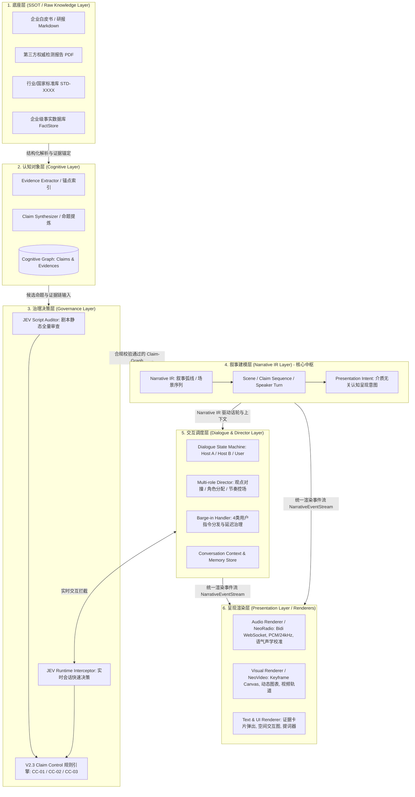

# NeoNarrative 核心系统架构设计规范 (System Architecture Specification)

**文件标识**: `ARCH-001-SYSTEM-ARCHITECTURE`  
**系统名称**: NeoNarrative (Knowledge Narrative Engine / 知识叙事引擎)  
**当前状态**: Approved / Architecture Specification v2.0  
**核心哲学**: **Media-Agnostic（介质无关）** 与 **Model-Provider-Decoupled（模型提供商解耦）**  

---

## 1. 架构愿景与设计哲学

### 1.1 从单介质工具向跨介质叙事底座跃迁
传统音频生成系统（如 NotebookLM）通常是将文档输入大模型后直接产出双人对话文本，并推入 TTS 朗读。这种架构具有严重的介质绑定与合规黑盒问题：
1. **介质耦合**：叙事结构直接与具体音频模型、音轨紧密绑定，无法重用至知识视频、互动简报或图文长卷；
2. **缺乏认知中间表示 (No Narrative IR)**：从文本直接跳跃到语音，缺少能够解耦表达“讲什么、为何现在讲、证据是什么、呈现意图是什么”的中介实体；
3. **模型深度绑定**：如果与特定模型（如 Gemini Live）强耦合，底层一旦切换模型供应商，整个叙事与合规逻辑全部坍塌。

NeoNarrative 确立了全新的六层解耦模型：
**将“知识理解—命题生成—证据追溯—JEV合规治理—叙事中间表示 (Narrative IR)”作为系统核心资产底座，而将 Gemini、Claude 或本地语音合成作为外部 Model Provider，将 NeoRadio（音频）、NeoVideo（视频）作为无状态外围渲染器（Renderers）。**

---

## 2. 系统六层分层架构拓扑



---

## 3. 六层架构职责与边界

### 3.1 Layer 1: 底座层 (SSOT Layer)
* **职责**：企业权威知识的单一可信源。包含标准文件、检测报告、白皮书。
* **边界**：只读不可篡改，提供确定性的 URI 物理定位。

### 3.2 Layer 2: 认知对象层 (Cognitive Layer)
* **职责**：从无序文本中提取机器可计算的实体：`Evidence`（证据锚点）与 `Claim`（命题断言）。
* **规范**：严格结合 V2.3 Claim Control 规范划分四个级别（`CONFIRMED_FACT`, `DERIVED_EXPLANATION`, `STRATEGIC_DIRECTION`, `FORBIDDEN_ASSERTION`）。

### 3.3 Layer 3: 治理决策层 (Governance Layer)
* **职责**：执行机器级确定性认知治理。实施事实溯源校验、因果关系解耦 (Rule CC-02)、表达强度降维 (Rule CC-03) 与红线断路器拦截。
* **边界**：拥有独立于生成模型的“一票否决权（Veto Power）”，输出 PASS/WARN/BLOCK/HUMAN_REVIEW 裁决。

### 3.4 Layer 4: 叙事建模层 (Narrative IR Layer) —— 介质无关的唯一中枢
* **定位**：**Cognitive Layer 与 Presentation Layer 之间的唯一中间表示（Intermediate Representation）**。
* **职责**：定义“讲什么、为何现在讲、命题演进顺序、谁来讲、必须出具何种证据、何处允许深挖展开、以及何种认知呈现意图（Presentation Intent）”。
* **铁律**：**Narrative IR 严禁直接绑定任何音频参数（如音高/语速/PCM）或视频素材（如特定图片URL/剪辑轨）**。

### 3.5 Layer 5: 交互调度层 (Dialogue & Director Layer)
* **职责**：驱动多角色（Host A、Host B）对话演进，并在用户实时介入时执行状态机仲裁与分层打断（Barge-in）处理。

### 3.6 Layer 6: 呈现渲染层 (Presentation Layer)
* **定位**：纯下游的介质适配器。接收 Narrative IR 与运行时事件，翻译为特定物理媒体。
  * `AudioRenderer` (NeoRadio)：将 Presentation Intent 解释为口语解释、声学重音与语速停顿；
  * `VideoRenderer` (NeoVideo)：将 Presentation Intent 解释为三维地图下钻、图表动画或画中画证据；
  * `TextRenderer` (UI)：解释为结构化消息气泡、可交互数据表与原文高亮浮层。

---

## 4. 介质无关呈现意图 (Presentation Intent) 抽象规范

在 Narrative IR 中，严禁出现具体媒体指令（例如“在此处播放一段 5 秒的西藏风景视频”或“在此处弹出一张 1080p 地图”）。取而代之的是纯粹的认知呈现意图：

```typescript
export type PresentationIntentType =
  | 'SPATIAL_CONTEXT'      // 空间位置与地理上下文
  | 'DATA_EMPHASIS'        // 关键数据定量强调
  | 'EVIDENCE_REVEAL'      // 原始证据溯源展示
  | 'COMPARISON'           // 多维度对照辨析
  | 'PROCESS_EXPLANATION'  // 工艺/因果演进机理
  | 'TIMELINE'             // 历史演进与时序沿革
  | 'QUOTE_SOURCE'         // 权威资质与机构出处引用
  | 'CONCEPT_RELATION';    // 概念层级与因果网络
```

### 多介质自适应解释映射矩阵 (Renderer Mapping Matrix)

| Presentation Intent | AudioRenderer (NeoRadio) | VideoRenderer (NeoVideo) | Text/UI Renderer |
| :--- | :--- | :--- | :--- |
| **`SPATIAL_CONTEXT`** | 声学语言空间定位描述（“咱们把视线拉到喜马拉雅山脉北麓的高原河谷…”） | 自动调取 3D 地理镜头推入与等高线地形图版 | 渲染可交互 GIS 空间地图或地理信息卡片 |
| **`DATA_EMPHASIS`** | 口语化重读数值，加入顿挫与反差对比语调（“注意，不是百分之七十，是整整百分之九十五！”） | 动态数字增长动画（CountUp）、高亮柱状图/对比雷达图 | 粗体彩色 Badge、定量指标对比表格 |
| **`EVIDENCE_REVEAL`** | 念出权威检测报告编号、检测机构与核心指标结论 | 视频画中画浮现盖章检验报告 PDF 扫描件，红框定位 | 界面右侧滑出 Evidence 详情抽屉，支持原文精准溯源 |
| **`COMPARISON`** | 双主持人分角色快速正反辩驳交锋 | 分屏（Split Screen）对比渲染左右两套技术方案 | 并排对照表格（Diff Table） |

---

## 5. 统一渲染器接口契约 (Universal Renderer Contract)

所有渲染器对外必须遵循统一抽象生命周期接口，确保内核介质无关性：

```typescript
export interface IRenderer {
  readonly rendererType: 'AUDIO' | 'VIDEO' | 'TEXT' | 'COMPOSITE';
  readonly rendererId: string;

  /**
   * 初始化并与特定媒体通道握手
   */
  initialize(config: Record<string, unknown>): Promise<void>;

  /**
   * 消费 Narrative 场景或话轮事件
   */
  renderScene(scene: NarrativeScene): Promise<void>;
  renderTurn(turn: NarrativeTurn): Promise<void>;

  /**
   * 解释并执行介质无关呈现意图
   */
  handlePresentationIntent(intent: PresentationIntentPayload): Promise<void>;

  /**
   * 极速物理中断 (Barge-in L1 级调用)
   */
  interrupt(): Promise<void>;

  /**
   * 销毁与释放资源
   */
  dispose(): Promise<void>;
}
```

---

## 6. 反事实架构自检：“去掉 Gemini 后还剩什么？”

**如果明天将 Gemini API 全部拿掉（替换为 Claude、DeepSeek、开源自研或纯本地引擎），NeoNarrative 绝不会坍塌：**

```
┌─────────────────────────────────────────────────────────────┐
│                 NeoNarrative 永恒核心资产                    │
├─────────────────────────────────────────────────────────────┤
│ 1. 知识库 SSOT 与 Evidence 锚点索引                         │
│ 2. V2.3 Claim 图谱与因果依赖网络                            │
│ 3. JEV 机器级合规治理规则引擎 (CC-01/02/03 确定性裁决)      │
│ 4. 核心 Narrative IR 规范 (叙事弧线、场景模型、Presentation Intent) │
│ 5. 三方对话状态机与分层打断协议                             │
│ 6. 介质无关的 IRenderer 接口体系                            │
└─────────────────────────────────────────────────────────────┘
                               ▲
                               │ 驱动与渲染注入 (完全解耦)
┌──────────────────────────────┴──────────────────────────────┐
│                  可插拔的外部 Provider (无状态)              │
├─────────────────────────────────────────────────────────────┤
│ • Model Provider (Gemini / Claude / DeepSeek / 本地 Llama)   │
│ • Speech Provider (Gemini Live / CosyVoice / Azure Speech)   │
│ • Visual Provider (Remotion / Three.js / WebGL Canvas)       │
└─────────────────────────────────────────────────────────────┘
```
Gemini 只是当前阶段在 `Model Provider` 和 `Speech Provider` 上的一个具体技术选型，NeoNarrative 的全部领域智能和合规资产彻底独立于任何单一第三方模型。
